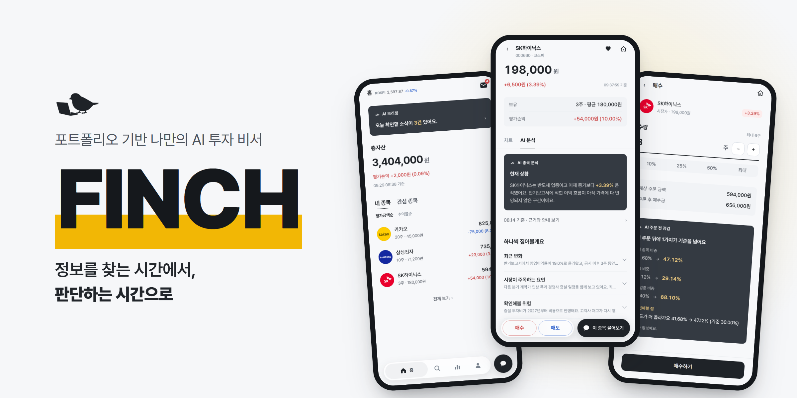
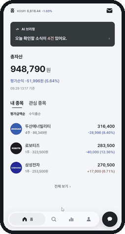
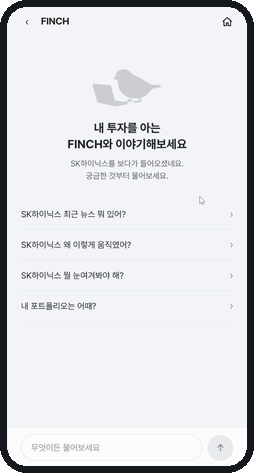
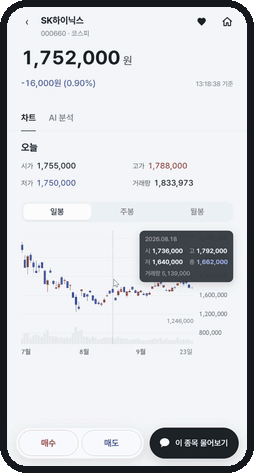

# 내 계좌와 성향을 읽고 투자 판단을 돕는 AI 비서가 있는 증권 앱

### FINCH

2026.08–09 · 6주 · 5인 · SSAFY 특화 · 프론트엔드 구현 전반

<a href="https://finchapp.org"><picture><source media="(prefers-color-scheme: dark)" srcset="https://img.shields.io/badge/Live-4C6CB3?style=for-the-badge"></picture></a> <a href="https://youtu.be/4Cbu0-vMve4"><picture><source media="(prefers-color-scheme: dark)" srcset="https://img.shields.io/badge/Demo-4C6CB3?style=for-the-badge&logo=youtube&logoColor=white"></picture></a> <a href="https://github.com/Team-FINCH/finch-frontend"><picture><source media="(prefers-color-scheme: dark)" srcset="https://img.shields.io/badge/Repo-4C6CB3?style=for-the-badge&logo=github&logoColor=white"></picture></a>

---

**묻는 판을 만들고, 기다리는 시간을 문서로 메움**

## 담당 범위

- 종목 상세와 AI 채팅을 비롯해 프론트엔드 구현 전반을 맡음
- 백엔드·AI 파트와 주고받는 API 계약을 프론트 쪽에서 관리함
- 실제 서버 대신 응답을 돌려주는 목 서버도 작업 범위에 포함함

| 영역 | 맡은 범위 |
|---|---|
| 화면 | 종목 상세 · 홈 · AI 채팅 · 예수금 · 주문 · 거래내역 · 문의함 |
| 기능 | 백엔드가 중계하는 시세의 화면 단위 구독·해제, 기간별 캔들 차트, 수량 기반 시장가 매수·매도 |
| 협업 기반 | API 계약 문서 관리 · 목 서버(MSW) · 프론트 규약 |

- 프론트엔드 영역 커밋 692건 중 510건(74%), master에 머지된 작업 브랜치 204건 중 156건(76%)을 담당함
- 다른 프론트엔드 팀원은 포트폴리오·인증 화면과 디자인 문서를 맡음
- 아래 사례에는 에이전트가 제안하거나 구현한 부분도 있음
  - 그때 내 몫은 무엇을 요청하고 어떤 안을 받아들일지 정하는 것

에이전트를 감독관·워커·튜터로 나눠 쓴 방식은 따로 적음

**[상세 보기 — 에이전트 하네스 v2 · FINCH](harness.md#v2-finch에서는-계층을-셋으로-나눔)**

### 화면

- **움직여야 보이는 것만 둠**
  - 아래 셋은 이 글이 다루는 판단이 실제로 어떻게 보이는지에 해당함
- 정지 화면으로 충분한 나머지와 제품 소개는 팀 저장소에 있음

| **종목 상세** | **AI 채팅** | **매수** |
| :---: | :---: | :---: |
|  실시간 시세 갱신과 기간별 캔들 차트 |  대기 표시 뒤 답이 한 글자씩 나오고 근거 출처가 따라옴 |  수량과 예상 금액, 주문 전후 비중 비교, 체결 뒤 보유 반영 |

---

## 질문을 보냈는데, 무엇이 남았는지 몰랐음 <!-- kind: 결정 -->

- 다른 파트에 물어볼 일이 생기면 팀 채팅에 상대를 태그함
- 대화가 쌓이면 질문도 밀림
  - 답이 오지 않은 것인지, 답을 놓친 것인지 알려면 이전 대화를 다시 읽어야 했음
- API 계약을 확정할 시점이 다가오는데 **무엇이 미결인지 한눈에 볼 곳이 없었음**
- 채팅 말고 문의와 요청을 따로 쌓을 자리가 필요하다고 팀에 제안함

- 새 도구를 들이지 않고 팀이 이미 쓰는 도구 안에서 자리를 찾음
  - 팀 채팅 전용 채널 — 이미 채널이 많아 하나 더 늘리는 부담 때문에 접음
  - Jira — 티켓은 우리가 할 일이고 문의는 남이 답할 일이라 추적 단위가 달랐음
  - 팀 위키 — 팀장이 파트별 페이지에서 본문 수정과 코멘트로 주고받자고 제안했고, 처음에는 괜찮게 봤음
    - 문의가 쌓이면 하위 페이지를 나눠도 비대해지고 읽기 어려워질 것으로 봄
    - 찾아보니 위키는 팀 안에서 잘 변하지 않는 규칙을 두는 자리였음

- **GitLab 이슈 보드를 문의와 요청 자리로 쓰는 방법을 착안함**
  - 처음에는 이슈가 작업을 나누는 단위 아닌가 싶었음
  - 작업 단위는 이미 Jira 티켓이 맡으니, GitLab 이슈는 문의와 요청 전용으로 써도 된다고 판단함
- 본문 체크박스의 진행률이 **`6 of 12`처럼 목록 화면에 보임**
  - 대화를 다시 읽지 않고도 남은 항목을 볼 수 있었음
  - 답이 스레드로 쌓이고, 라벨로 파트를 거를 수 있음

- 질문 양식과 운영 규칙을 세운 뒤, 받는 사람 기준으로 깎음
  - 처음 넣었던 마일스톤과 복잡한 라벨 규칙을 지움
  - 받는 사람의 일은 **이슈를 열고, 번호에 맞춰 댓글로 답하고, 체크박스를 누르는 것**으로 줄임
  - 라벨은 보내는 쪽에서 붙이게 함

- 짧게 줄인 질문도 뜻이 통하지 않아 다시 씀
  - 「구독」이 통신 프로토콜의 구독, 관심 종목 등록, 실시간 시세 슬롯 할당이라는 세 층으로 쓰이고 있었음
  - 여러 뜻으로 쓰이는 말에는 **무엇을 묻는 것이 아닌지**까지 적음
- 프론트의 가정을 적고 「맞나요」라고 묻던 문장도 바꿈
  - 상대 파트가 정할 것을 먼저 정해 통보하는 모양이었음
  - 가정 대신 선택지를 적고 해당 파트가 고르게 함

- 쓰기 시작한 뒤에도 양식을 다시 고침
  - AI 도구를 덜 쓰는 팀원에게서 양식을 채우기 어렵고 본문이 길어 읽기 힘들다는 피드백을 받음
  - 팀원마다 AI 도구를 쓰는 정도가 다르다는 것을 설계 때 한 번 반영했는데, 실물에서 다시 걸린 것이었음
- 사람이 그대로 읽고 답하기 쉬운 길이로 다시 씀

- 아래는 2026년 8월 21일부터 9월 24일까지의 기록임

| 확인한 것 | 결과 |
|---|---|
| 사람이 작성한 이슈 | 105건, 봇 작성 1건 제외 |
| 작성에 참여한 사람 | 팀 전원 |
| 다른 팀원들이 올린 이슈 | 43건 |
| 내가 올린 이슈에 다른 사람이 답한 경우 | 62건 중 48건 |

- 이슈는 GitHub의 파트별 공개 저장소 다섯에 흩어져 있으며, 각 저장소에서 `GitLab 이슈` 라벨로 열 수 있음
- 질문을 모아 두는 데서 끝나지 않고 다른 파트도 문의를 남기고 답하는 자리가 됨

**이 판단의 한계**

- 기능적으로 옳은 것을 먼저 만들고 받는 사람 입장을 나중에 생각한 일이 반복됨
  - 다음에는 상대가 무엇을 읽고 어떻게 답해야 하는지부터 세 줄로 적을 예정
- 체크박스는 누가 눌렀는지 남지 않고, 비슷한 시각에 누르면 나중 저장이 앞 것을 덮어씀
- 여러 항목을 묶으면 부분 완료를 목록에서 구별하기 어려운 한계도 있었음
  - 건별로 쪼개면 받는 쪽 부담이 커져, 묶은 채 시작하고 실제 덮어쓰기가 나면 나누기로 함

---

## 확정된 것과 가정한 것을 문서로 갈라 두고 먼저 만듦 <!-- kind: 결정 -->

- 다른 파트의 API 계약 회신을 기다리다 개발이 막힘
  - 「일단 적어 두고 먼저 개발하자」고 제안함
- 처음부터 임의로 정하지 않고 당장 구현할 수 있는 부분부터 진행함
  - 남은 것은 구두로 맞추고, 그래도 정해지지 않은 부분만 에이전트와 함께 가정함
- 계약 문서에 **확정된 것 · 미확정인 것 · 문서끼리 충돌하는 것**을 갈라 둠
  - 미확정 항목도 빈칸 대신 무엇을 기다리는지 적음
- 문서를 프론트 쪽에서 맡아 관리한 것은 내 몫이었음
  - 문장을 쓰고 갱신하는 작업은 에이전트가 맡음

- AI 채팅 생성이 비동기 작업으로 바뀐 계약이 이 방식의 사례였음
  - 요청을 계속 열어 둔 채 답을 기다리다가 화면을 옮기면, 생성 비용은 나가는데 답은 사용자에게 닿지 않는 문제가 있었음
  - 작업을 먼저 접수하고 결과를 나중에 받는 방식으로 바뀌었으나, 백엔드 경로는 아직 확정되지 않았음
- 이 건은 잠정 확정으로 받고 먼저 진행하기로 직접 정함

- 에이전트가 장치 둘을 제안함
  - 서버 응답을 화면에서 쓰는 형태로 바꾸는 어댑터 하나에 가정을 모으는 안이었음
  - 문서에 **가정이 틀렸을 때 고칠 범위**를 미리 적는 칸도 제안함
- 확정 뒤 어디까지 되돌리면 되는지 미리 알 수 있다는 취지를 이해하고 받아들임
- 문서의 기준은 **「되돌리는 비용이 보이지 않으면 잠정으로 정하지 않는다」였음**
  - 고칠 자리를 지목할 수 없는 항목은 가정하지 않고 회신을 기다리는 뜻이었음

- 실제 가정은 한 곳에서 틀렸음
  - 작업 번호가 따로 오는 줄 알았으나, 공통 응답 형식 안에 담겨 왔음
- **이 건에서는 어댑터와 목 서버만 고쳤고 화면 코드는 바뀌지 않았음**
  - 미리 적어 둔 수정 범위와 같았음
  - 뒤에 열린 백엔드 경로 이름은 추정한 값 그대로였음

- 대신 문서를 계속 따라 고쳐야 했음
- 뒤에 에이전트에게 계약을 다시 대조하게 하자, 이미 확정되거나 회신이 왔는데도 미확정으로 남은 항목이 드러남
  - 먼저 개발할 수 있게 해 준 문서가 구현보다 뒤처져 있었음

**이 판단의 한계**

- 화면 코드가 바뀌지 않은 것은 채팅 계약 한 건의 결과였음
  - 가정이 늘 맞았다거나 늘 같은 범위에서 고쳐졌다는 뜻은 아님
- 문서 갱신이 구현보다 늦으면 다음 작업에 낡은 가정을 넘김

---

## 401만 보고 사용자를 로그아웃시키면 안 됐음 <!-- kind: 결정 -->

- 프론트의 인증 인터셉터는 응답을 공통으로 가로채 인증 토큰 만료를 처리하는 자리였음
  - 만료를 감지하면 토큰을 재발급하고 원래 요청을 다시 보내도록 할 예정이었음
- 흔한 기준은 **인증이 유효하지 않다는 HTTP 응답인 401을 사용자 세션 문제로 보는 것이었음**

- 그런데 팀 API 명세는 AI 서버가 낸 오류 코드와 상태를 백엔드가 그대로 통과시키도록 정하고 있었음
  - 재시도해도 소용없는 오류와 재시도할 수 있는 오류를 화면에서 구분하려면 필요한 규칙이었음
- 백엔드와 AI 서버 사이에도 내부 인증이 있었음
  - 내부 토큰 불일치로 난 401까지 화면에 내려오면 사용자 세션 만료로 오인할 수 있었음
  - 상태 숫자만 보면 **AI 분석을 누른 사용자가 멀쩡한 세션을 잃을 위험이 있었음**

- **문제를 처음 짚은 것은 백엔드였음**
- 그 지적을 확인하려고 AI 명세를 열어 봄
  - 401 발생 조건은 내부 토큰 불일치였는데 프론트 처리 칸에는 「재로그인」이라고 적혀 있었음

- 에이전트가 처음 낸 안은 AI 요청을 공통 처리에서 빼는 것이었음
- 그 안을 기각함
  - AI 요청에도 공통 헤더와 오류 응답 처리가 필요해 같은 코드를 두 벌 두게 됨
  - 예외로 뺄 경로가 늘어나고, 목록 갱신을 잊으면 방어가 조용히 뚫림

- **대신 아는 코드일 때만 세션을 건드리는 기준으로 뒤집음**
  - 인터셉터는 하나로 두고 사용자 인증 오류 코드 셋만 세션 처리 대상으로 삼음
  - 나머지는 세션에 손대지 않고 요청한 화면에 넘기도록 정함

- 차이는 모르는 응답이 왔을 때 드러남
  - 401 전체를 세션 문제로 보면 모르는 401도 재발급이나 로그아웃으로 이어짐
  - 아는 코드만 처리하면 모르는 코드는 세션을 바꾸지 않음
  - 코드 필드가 없는 응답도 목록에 맞지 않아 세션 처리에서 빠짐
- 이 기준은 인터셉터 구현 전에 정함
  - 실제 인터셉터 구현은 다른 프론트엔드 팀원이 맡음

**이 판단의 한계**

- 고른 코드 이름이 우리 서비스의 사용자 인증에서만 나와야 성립함
  - AI 파트가 나중에 같은 이름을 추가하면 구분이 깨짐
- 코드 이름이 겹치지 않도록 이슈로 합의를 요청함
  - 백엔드 공통 오류 목록과 AI 명세에 이미 같은 이름이 있다는 것을 겹침이 가능한 증거로 적음
- AI 파트 회신은 8월 28일에 왔고, 백엔드 회신은 그때까지 오지 않았음

---

## 시세 받는 방식을 화면 밖으로 숨긴 안을 승인했지만, 바꿔 보지는 못함 <!-- kind: 남김 -->

- 팀 계약은 화면이 시세를 구독하고 해제하는 동작만 알도록 요구했음
  - 나중에 값을 받는 방식이 바뀌어도 화면까지 고치지 않으려는 경계였음
  - 일정 주기마다 서버에 다시 묻는 폴링은 최종 구조의 대체 경로로 정해져 있었음

- 계약과 코드를 대조하도록 에이전트에게 요청함
- 그 경계가 문서에만 있고 코드에는 없다는 보고를 받음
  - 종목 · 홈 · 주문 영역의 시세 처리 세 곳이 각자 조회 훅을 직접 부르고 있었음
  - 화면도 그 훅이 내는 상태를 그대로 읽고 있어, 전송 방식을 바꾸면 **화면까지 수정이 번지는 상태였음**
- 보고를 받은 자리에서 고치지 않고 별도 이행 티켓을 열기로 정함

- 에이전트가 낸 안은 **화면은 구독과 해지만 알고 안쪽이 폴링인지는 모르는 구조였음**
  - 화면이 뜨면 구독하고 떠나면 해지하는 방식이었음
  - 기능 폴더끼리 서로 가져다 쓰는 것을 규약이 막고 있어 공용 계층에 두는 안이었음
- 그 뜻을 검토해 승인함
  - 세부 설계와 구현은 에이전트가 맡음
- 공용 훅 하나를 기존 시세 훅 셋과 주문 화면이 쓰게 됨

- 실제 데이터 수신은 폴링으로 남음
  - 서버가 값을 밀어주는 웹소켓 구현체는 시연 범위 밖으로 결정돼 만들지 않음

**이 판단의 한계**

- 전송 방식을 실제로 바꿨을 때 화면이 그대로인지는 **확인되지 않았음**
  - 지금 있는 것은 바꿔도 화면이 안 바뀌게 해 둔 구조이며, 실제 교체를 견디는지는 증명되지 않았음
- 경계를 어디에 두고 무엇을 돌려줄지도 에이전트가 낸 안이었음
  - 내 몫은 계약 대조를 요청하고, 이행 티켓을 열기로 정하고, 그 안을 승인한 것까지였음

---

## 어긋난 것을 고치기 전에, 왜 어긋났는지부터 물었음 <!-- kind: 결정 -->

- AI 채팅에서 답변 아래 근거 목록이 본문보다 길어지는 문제를 처리하고 있었음
- 상위 한 건만 펼치고 나머지는 접기로 정함
- 구현을 지시한 뒤 **그 결정이 팀의 화면 설계 문서와 부딪힌다**는 보고를 받음
  - 문서에는 근거 표시를 「접어두거나 생략하지 않는다」고 적혀 있었음

- 문서에 맞춰 결정을 되돌리거나, 문서를 조용히 고치거나, 어긋난 채 진행할 수 있었음
- 바로 고르지 않고 **그 문장이 왜 그렇게 적혔는지 앞뒤 맥락을 물음**
  - 이유를 모르는 상태에서는 되돌리는 것도 고치는 것도 근거가 없었음
- 같이 적은 이유는 **문서와 구현이 다르면 나중에 또 회귀한다는 것이었음**
  - 지금 결정이 옳더라도 다음 사람이 문서를 보고 되돌리면 같은 논의를 다시 하게 됨

- 맥락을 확인하니 어긋남이 한 줄이 아니었음
  - 문서는 근거 표기를 전 화면 공통 규약으로 적었으나 실제 화면마다 다르게 그리고 있었음
- 진행 중이던 채팅 작업에 얹지 않고 별도 티켓으로 뗌
  - 기능 변경과 문서 정리를 섞으면 리뷰할 때 범위가 갈리지 않음
- 에이전트가 문서를 지금 구현에 맞추는 방향을 제안했고 승인함
  - 문서대로 되돌리려면 코드 네 군데를 고쳐야 하며, 그 판단은 이 티켓 범위 밖이라는 보고를 받음

- 작업 과정에서 에이전트가 어긋남이 오래 남은 이유를 짚음
  - 문서와 코드 주석이 둘 다 **이미 폐기된 절차가 나중에 정리할 것이라고 적고 있었음**
  - 정리를 맡을 절차가 사라졌는데 그것을 가리키는 문장은 그대로 남아 있었음

- 에이전트가 문서 세 절을 지금 화면에 맞춰 다시 씀
  - 항목마다 언제 왜 바뀌었는지 변경 요청 번호와 날짜로 남김
  - 폐기된 절차를 가리키던 문장은 끊음
  - 아직 정하지 않은 것은 누가 언제 정하는지 적음
- 같은 날 다른 팀원이 리뷰하고 머지함

**이 판단의 한계**

- 폐기된 절차를 가리키는 문장이 회귀 고리였다는 진단은 에이전트가 도달한 것이었음
- 내 몫은 맥락을 묻고, 별도 티켓으로 열고, 문서를 구현에 맞추는 방향을 승인한 것까지였음
  - 문서를 대조하고 고치는 작업도 에이전트가 맡음

---

## 내가 올리자고 한 이슈가 틀렸음 <!-- kind: 틀림 -->

- 장 시간 밖에도 백엔드가 외부 시세 API를 계속 부른다는 문제를 이슈로 올리자고 함
- 본문에는 **「프론트 폴링을 멈춰도 이 문제는 그대로입니다」라고 단정함**
  - 클라이언트 요청과 무관하게 서버가 스스로 수집한다고 적음

- 백엔드가 두 가지를 되물음
  - 이미 캐시에 저장된 값을 보내고 있다는 반박이었음
  - 프론트가 계속 요청하는 것부터 멈춰야 하는 것 아니냐는 지적이었음
- 우리 주장을 방어하지 않고 무엇이 맞는지부터 확인해 달라고 에이전트에게 요청함
  - 먼저 단정한 쪽이 우리라 틀렸을 가능성도 우리 쪽에 더 있다고 봄

- **백엔드 코드를 읽고 판정한 것은 에이전트였음**
- 보고받은 종목 시세 수집 방식은 우리 설명과 달랐음
  - 시세를 묻는 행위 자체가 관심 신호였음
  - 묻지 않으면 잠시 뒤 그 종목이 수집 대상에서 빠지는 구조였음
  - 프론트의 반복 요청이 수집을 계속 살려 두고 있었음
- 반면 지수는 요청과 무관하게 수집하고 있었음
  - 두 종류가 같은 곳에 있어 같은 규칙으로 읽은 것이 착오였음

- 캐시 값을 보내고 있다는 반박은 맞지만 다른 층의 이야기였음
  - 캐시에서 응답하는 것과 그 캐시를 채우려고 외부 API를 부르는 것은 별개였음
  - 종목 시세에서는 조회가 관심 신호를 갱신하므로 캐시 응답이라도 외부 수집과 무관하지 않았음

- 에이전트가 낸 정정 내용을 검토해 승인함
  - 지수는 백엔드 수집에 시간 조건을 넣어 달라는 요청을 유지함
  - 종목 시세는 프론트가 장 운영 여부를 알 수단을 요청하기로 함
  - 장 시간을 프론트 코드에 직접 넣는 안은 휴장일을 알 수 없고 공휴일 목록까지 프론트가 관리해야 해 접음
- 3초 주기는 백엔드 수집 주기에 맞춘 값이었음
  - 그래도 장 시간 밖에 같은 주기를 유지할 이유가 없다는 지적은 옳았음
- 이슈에 정정을 올림
  - 틀린 단정이 적힌 원문과 정정이 공개 저장소 이슈에 그대로 남아 있음

**이 판단의 한계**

- 상대가 짚어 준 뒤에야 확인함
  - 그 전까지 틀린 설명이 팀 이슈에 남아 있었음
  - 다음 사람이 그것을 근거로 삼을 수 있었음
- 팀에 보낼 사실 주장은 코드로 확인하고 보낼 예정

---

## 기술 스택

---

- 정리 이전 판은 [`_archive/2026-10-27_finch_볼트재작성전.md`](_archive/2026-10-27_finch_볼트재작성전.md)에 보관
- 무엇을 왜 바꿨는지는 [`_archive/README.md`](_archive/README.md) 참조