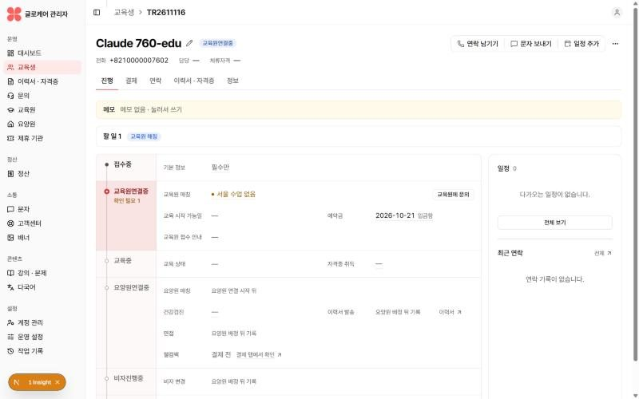
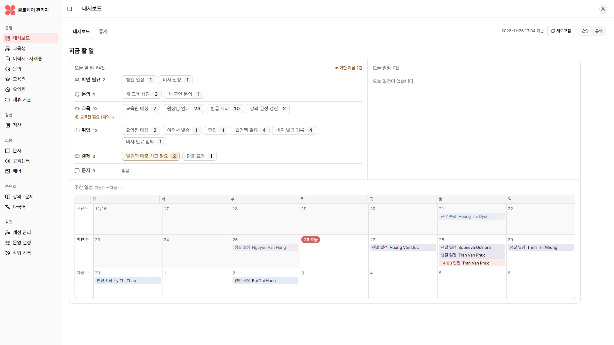
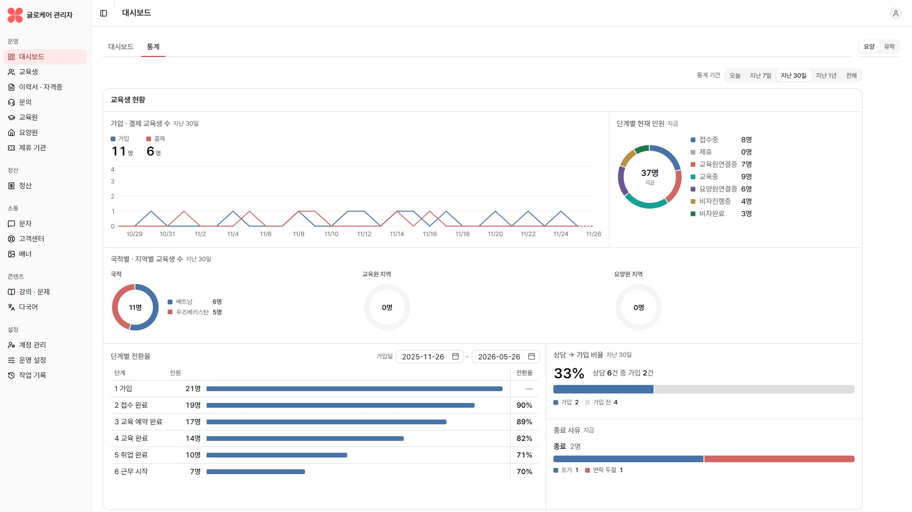

# 외국인 요양보호사의 교육부터 취업까지 한 곳에서 돕는 서비스

### 글로케어

2026.10–11 · 6주 · 6인 · SSAFY 자율 · 기업 연계 · 어드민 · 인프라

<a href="https://k15a401.p.ssafy.io/"><picture><source media="(prefers-color-scheme: dark)" srcset="https://img.shields.io/badge/Demo-4C6CB3?style=for-the-badge"></picture></a>

---

**운영 중이던 서비스의 관리자 페이지를 맡아, 직원이 수동으로 켜던 진행 단계를 결제 · 배정 기록으로 계산하게 바꾸고 팀의 개발 서버와 CI도 운영했다**

## 한눈에

- 서비스: 외국인 요양보호사의 가입부터 교육 · 취업까지 돕는 서비스로, 교육생이 쓰는 교육생 웹과 기업 직원이 쓰는 관리자 페이지(어드민) 두 앱을 6인이 만듦
  - 팀 구성은 PM 1 · DB 1 · 교육생 웹 2 · 어드민 2
  - 기존 관리자 페이지에는 교육생 웹에 입력된 값이 자동으로 반영되지 않아 직원이 수동으로 입력하고 따로 관리했음
  - 기존 코드는 참고만 하고 어드민을 거의 새로 구현함
- 내 몫: 어드민 기능을 다른 팀원 한 명과 티켓 단위로 나눠 맡고 2026-10-24부터 팀의 개발 서버와 CI를 담당함
  - 코드 대부분은 AI 코딩 에이전트가 쓰고, 무엇을 만들지 · 어떤 안을 고를지 · main에 넣을지를 정하고 미리보기와 측정으로 확인함
- 주소
  - 서비스: 런칭 예정 · 주소 미정
  - 리뉴얼 시연: [k15a401.p.ssafy.io](https://k15a401.p.ssafy.io/) — 팀이 만든 교육생 웹(팀 개발 서버)
  - 어드민은 회사 내부 화면이라 공개 주소가 없고, 아래 화면은 더미 데이터로 찍음
  - 팀 저장소는 SSAFY GitLab 비공개
- 작업 규모(2026-11-20 GitLab · Jira 조회)
  - 내가 올려 머지된 MR 285건(2026-10-19 ~ 11-20) · 팀 전체 머지 MR 1,246건
  - 리뷰어로 들어간 머지 MR 193건
  - 내 Jira 완료 티켓 201건 · 팀 완료 831건
  - 작업은 SSAFY GitLab과 Jira에서 진행해 GitHub 기여 기록에는 나타나지 않음

<!-- Lighthouse 결과 자리: 측정 결과를 받으면 이 아래에 넣음 -->

| 영역 | 맡은 일 |
|---|---|
| 요구사항 기준 | 우리 쪽 이해의 기준을 기업 자료 → 팀장 기능 목록 → 팀 최종 요구사항 · 기능명세 시트로 옮기고, 명세에 없는 기능을 깎음 |
| 교육생 진행 단계 | 결제 · 교육원 배정 · 날짜 · 문자 기록에서 진행 단계를 판정하는 기준을 정하고, DB 함수로 옮겨 갈 때 앱 판정 코드를 지우는 쪽을 고름 |
| 직원 계정 · 역할별 권한 | 직원 계정 관리와 역할별 권한 작업을 맡고, 운영 실정을 들어 역할별 권한을 DB 담당에게 제안함 |
| 교육생 목록 · 상세 | 목록 · 상세 탭 · 학습 현황 · 진행 단계 연결 · 상세에서 문자 · 결제로 바로 가기 작업을 맡음 |
| 대시보드 · 화면 개편 | 대시보드 통계 지표 구성, 어드민 화면 전체 개편의 범위 · 방향, 로딩 개선에서 남길 것과 되돌릴 것을 정함 |
| 공지 · FAQ 관리 | 목록 · 공개 여부 · 순서 · 작성 · 수정 작업을 맡고, 한국어 원문 우선 공개 정책을 정함 |
| 개발 서버 · CI | 구성의 전제와 일부 선택을 직접 정하고 나머지는 에이전트 안을 승인함 · 팀 머지 조건을 켜고, 느린 원인 분석을 맡김 |
| 회사 이관 준비 | 이관 조건을 알리고 점검 · 조사 범위를 정해 맡김 |

## 화면

교육생 상세의 진행 탭 · 진행 단계와 다음 할 일을 결제 · 배정 기록에서 계산해 보임 · 더미 데이터

대시보드 첫 화면 · 오늘 할 일 건수와 주간 일정 · 더미 데이터

대시보드 통계 탭 · 기간을 골라 운영 지표를 봄 · 더미 데이터

---

## 요구사항의 기준을 기업 자료에서 팀 최종 시트로 옮기며 넓혀 둔 기획을 깎음 <!-- kind: 틀림 -->

- 팀 코드 저장소를 받기 전 기획 단계에서 우리 쪽 이해와 문서를 무엇에 맞출지 정해야 했음
- 먼저 에이전트에게 기업 공식 자료와 우리 이해를 대조하라고 하고 판단이 필요한 항목마다 따를 기준을 정함
- 같은 날 팀장이 정리한 기능 목록이 나오자 다시 비교를 맡기고 항목마다 반영 여부를 결정함
  - 명세에 없는 연락 수단 등은 기획을 임의로 넓힌 것이라고 인정하고 뺌
  - 필수 기능을 받치는 핵심만 먼저 두고 이후 살을 붙이는 MVP로 범위를 깎음
- 명세가 분명하지 않은 결제 확인 · 예약금 처리는 멘토에게 묻기로 하고 문서는 팀장 최종판과 이후 멘토링 답에 맞추게 함
- 팀 최종 요구사항 · 기능명세 시트가 나온 뒤에는 그 시트에 회원 탈퇴를 더한 것을 프로젝트 확정 기준으로 삼음
- 에이전트가 새 내용을 날짜를 붙여 덧붙이자 앞선 이해가 잘못됐던 것이지 정책이 바뀐 게 아니라고 지적함
  - 기준 문서는 맞는 내용으로 덮어쓰고 옛 이해는 보관 폴더로 옮기게 함
- 대조 · 문서 수정은 에이전트와 하위 에이전트가, 화면 시안 수정은 디자인 도구인 Claude Design이 맡았으며 시트는 팀 산출물이었음
  - 내 몫은 우리 이해가 따를 기준과 임의로 넓힌 범위에서 무엇을 깎을지를 정한 것이었음

**이 판단의 한계**

- MVP로 깎은 결정이 실제 구현에 어떻게 반영됐는지는 기록에 없음
- 이 기간의 상품 · 결제 이해는 팀 최종 시트 이전의 옛 이해여서 현재 정책으로 쓰지 않음

---

## 시험 화면에 번역 보기를 넣기로 했다가 나흘 뒤 되돌림 <!-- kind: 틀림 -->

- 컴퓨터 기반 시험인 CBT의 연습 · 실전 모의시험 화면을 준비하면서 「번역 보기」를 둘지 정해야 했음
- 에이전트는 실제 시험과 비슷하게 하려면 두지 않는 쪽을 권했으나 그 권고를 따르지 않고 넣기로 함
  - 토글을 켜면 한국어 문항 아래에 선택한 언어를 작게 함께 보이게 하는 안이었음
- 나흘 뒤 기업탐방에서 들은 「CBT 안은 한국어」라는 방향과 어긋난다고 보고 토글을 지우기로 함
  - 기업이 이미 방향을 말한 사안이어서 토글을 남긴 채 다시 확인하는 안은 접음
  - 처음에 두지 말자던 에이전트의 권고가 맞았음
- 당시에는 연습문제 · 오답노트 · 해설에만 토글을 두고 실전은 실제 시험 화면처럼 한국어만 보이게 하기로 함
- 토글이 퍼져 있던 규칙 · 디자인 시스템 · 프롬프트를 찾아 함께 고친 것은 에이전트였고 화면은 Claude Design이 만듦

**이 판단의 한계**

- 연습 화면에 남긴 토글도 이후 팀 최종 기준에서 없어짐
  - 최종 기준에서는 연습과 실전 모두 문제 · 보기가 한국어로 나오고 해설만 고른 언어로 나옴
- 기업 방향을 짚은 당시 피드백 기록을 근거로 적었고 녹취 원본은 다시 열어 보지 않음

---

## 교육생의 진행 단계를 큰 단계 9개와 실제 기록으로 판정하게 정함 <!-- kind: 결정 -->

- 직원은 교육생 목록과 상세에서 교육생 한 명이 지금 어디까지 왔고 어떤 일이 남았는지 확인해야 했음
- 에이전트가 쓴 판정 초안의 입력 목록이 기존 서비스 기준으로 너무 자잘하게 나뉘어 있다고 보고 서비스에 맞게 다시 짜라고 함
  - 직원이 수동으로 켜는 표시보다 결제 · 교육원 배정 · 날짜 · 문자 발송 같은 실제 기록에서 판정하는 안을 택함
- 기존 단계의 「취업중」 · 「근무중」은 글로케어 직원으로 근무하는 뜻처럼 읽힌다고 지적함
  - 이름만 바꾸고 기존 단계를 유지하면 비자 진행이 큰 단계에서 보이지 않아 그 안은 접음
  - 팀원 · 멘토와 의논하며 접수중부터 교육 · 요양원 연결 · 비자 진행 · 근무 종료 등을 구분하는 큰 단계 9개를 정함
- 세부 판정 역시 직원이 실제로 하는 일과 DB에 남는 기록에 맞춤
  - 배정 완료는 교육원과 수업 일정이 함께 확정된 시점으로 잡고 교육원만 정해진 상태는 제외함
  - 강의 접수 문자는 자동 발송에 더해 직원이 직접 보낸 기록도 세기로 함
- 진행 단계와 판정 기준은 에이전트가 낸 후보에서 직접 골랐고, 판정 규칙을 적은 문서와 코드 · 테스트는 에이전트가 작성함
  - 상품 종류와 시트의 단계 정의는 회사 · 팀이 정한 것이고, 비자는 날짜만 추적한다는 방향은 멘토에게서 온 것이었음

**이 판단의 한계**

- 큰 단계 9개는 팀 시트의 8개를 고쳐야 하는 제안이었는데 시트에 반영됐는지는 확인하지 않음
- 같은 주에 팀장이 고친 진행 단계 판을 기준으로 다시 맞춤
  - 이때는 에이전트가 갈림길과 추천안을 정리했고, 그 추천을 검토 · 승인함

---

## 수동으로 켜던 진행 단계 칸은 14개에서 0개가 됐고, 늘어난 입력도 같이 셈 <!-- kind: 결정 -->

- 기존 관리자 페이지에서는 직원이 교육생 상세의 진행 단계 카드에 있는 단계 스위치 · 완료 표시 · 선택 칸을 켜고 끄며 단계를 정했음
  - 직원이 「등록」을 눌러야 접수 단계가 끝나는 구조였음
- 새 어드민은 앞 장의 기준대로 단계를 저장하지 않고 결제 · 수업 배정 · 문자 · 자격증 · 면접 · 비자 기록에서 읽을 때마다 계산함
- 처음에는 어드민 앱 코드가 이 판정을 계산했음
  - 목록 · 상세 · 대시보드와 교육생 웹이 같은 판정을 봐야 했고, 단계 필터가 교육생 전체 기록을 읽어 교육생이 많아지면 목록이 잘릴 수 있었음
- DB 담당이 같은 판정을 DB 함수로 만들자 어드민이 그 결과를 읽게 바꾸는 티켓에서, 앱 판정 코드를 지울지 대조용으로 남길지와 겹치는 범위를 한 번에 묻게 함
  - 에이전트가 함수와 앱 사용처를 대조하니 큰 단계는 글자까지 같았고 앱에만 있던 세부 상태는 화면에 나온 적이 없는 값이었음
  - DB 담당이 앱 판정 테스트와 실제 고객 데이터로 이미 대조했으므로 앱 판정 코드를 지우는 추천안을 택함
  - 리뷰어는 직접 정했고 그 리뷰어가 지적한 「함수가 실패하면 상세 전체가 오류」는 단계 칸만 비우도록 고침
- 마감 전 배분 세션의 하위 에이전트가 기존 코드와 새 코드를 읽어 같은 업무의 단계 수를 셈
  - 진행 단계를 정하려고 직원이 켜고 끄는 칸 14개 → 0개
  - 직원 계정 만들기는 설정 카드를 한 번 더 거치고 이름 · 역할 칸이 생겨 단계가 늘었음
  - 단계 계산의 재료인 기록 창에서도 필수 입력 칸이 늘었고 교육생 한 명의 진행 상태를 확인하는 단계 수는 같았음
  - 늘어난 칸은 역할별 권한과 날짜가 붙은 기록의 몫이고 그 기록이 곧 단계 입력이 됨

**이 판단의 한계**

- 함수는 DB 담당이 만들었고, 대조 · 구현 · 단계 수 측정은 에이전트 몫이었음
  - 내 몫은 판정 기준을 정한 것, 앱 판정 코드를 지우는 쪽과 범위를 고른 것이었음
- 단계 수는 코드를 읽어 센 값이고 화면을 직접 눌러 다시 세지는 않음

---

## 학습이 멈춘 교육생 찾기와 문자 보내기를 목록 · 상세에서 바로 하게 함 <!-- kind: 결정 -->

- 멘토링에서 직원이 교육생의 공부 상황을 챙길 수 있게 학습 수치를 보여 달라는 요청이 나옴
- 에이전트가 공용 DB에서 직원이 학습 기록을 읽는 길을 조사하니 세 군데가 걸림
  - 학습일 표에 강의 시청이 쌓이지 않아 강의만 본 교육생이 학습을 멈춘 것으로 보였음
  - 기록이 없는 교육생을 「학습 없음」에 넣으면 결제 전 가입자까지 모두 걸렸음
  - 앱에서 거르면 기준 일수를 늘리는 순간 한 번에 읽는 행이 한도를 넘어 조용히 잘렸음
- 에이전트가 낸 네 질문에서 추천안을 택함
  - 학습일에 강의 시청을 넣고 「학습 없음」 대상은 학습 이용권이 유효한 교육생만으로 둠
  - DB 함수를 요청하고 반영을 기다리는 동안 같은 계약으로 화면과 테스트를 먼저 만듦
  - 전후를 재기로 함
- 함수는 DB 담당이, 화면 · 테스트는 에이전트가 만들었고 리뷰를 거쳐 머지됨
  - 학습이 멈춘 교육생 찾기: 교육생 상세를 모두 열던 클릭 74번 → 목록 필터 클릭 2번
  - 개발 서버에서 같은 계정으로 전후 한 번씩 셈
- 같은 무렵 메뉴 배치를 실제 업무 기준으로 살피자고 꺼냈는데, 그 논의에서 교육생 상세에서 다음 업무로 바로 가는 버튼이 나옴
  - 상세에 이미 있는 길을 먼저 훑고 빠진 것만 더하라고 했고 권한이 없는 업무의 버튼은 숨기라고 함
  - 에이전트가 훑으니 상담 · 배정 · 이력서 · 결제 내역 읽기는 상세 탭에서 이미 됐고 빠진 것은 문자 보내기와 결제 · 환불 목록이었음
  - 탭에서 되는 일을 머리에 또 두지 않고 그 둘만 더하자는 추천을 따름
  - 상세에서 그 교육생에게 문자 보내기: 번호 끝자리를 다시 입력하던 4클릭 → 1클릭
  - 결제 목록은 클릭 수가 같되 그 교육생 한 건만 걸린 채로 열리게 됨

**이 판단의 한계**

- 조사 · 선택지 · 구현 · 측정은 에이전트 몫이었고, 내 몫은 범위를 정하고 추천안을 고른 것이었음
- 학습 수치 요청은 멘토링에서 나왔고 클릭 수는 찾는 경로를 센 값이며 업무 시간은 재지 않음

---

## 대시보드 지표의 제휴 기관 기준은 앱에서 임시로 가르지 않고 DB에 요청함 <!-- kind: 결정 -->

- 대시보드 통계 탭에 기간별 운영 지표를 넣는 티켓이었고 어떤 지표를 넣을지는 담당자가 DB에 있는 값 가운데서 골라 정하게 되어 있었음
- 에이전트가 DB 설계 문서에서 지표 후보를 조사해 고르기 화면으로 보였으며 판이 나올 때마다 고쳐 달라고 함
  - 모든 지표가 같은 막대로 보이던 시안을 숫자 성격에 맞는 그래프로 바꾸라고 함
  - DB에서 바로 센 값과 그것으로 계산한 값을 나눠 정리하게 함
  - 점이 쌓여 세기 어려운 그래프는 큰 숫자와 작은 주별 막대로 바꾸도록 함
- 저장 뒤 PM이 결제가 없는 제휴 기관 교육생은 교육생 통계에서 빼고 따로 세자고 했으나 가르는 DB 조건은 아직 정해지지 않았음
- 에이전트는 앱에서 가를 수는 있지만 진행 단계 · 교육생 목록 · 홈 숫자도 같은 조건을 써야 해 앱이 따로 정하면 어긋날 수 있다고 보고 세 가지를 물음
  - 조건은 DB 담당에게 새 티켓으로 요청하고 정해지기 전에는 모두 세되 「제휴 기관 교육생 포함(조건 미정)」 안내를 달자는 추천안을 고름
  - 조건이 나온 뒤에는 「통계표」에서만 일반 · 제휴를 나누고 다른 화면은 건드리지 말라고 범위를 좁힘
- 기간을 골라 볼 수 있는 운영 지표 0개 → 11개(카드 10 · 직전 기간 대비 증감 표 1, 머지된 코드에서 셈)

**이 판단의 한계**

- 지표 후보 조사 · 그래프 시안 · DB 요청 문안 · 구현은 에이전트 몫이었고, 제휴 기관 교육생의 집계 기준은 PM이 정함
- 면접 결과를 넣은 날짜 칸이 없어 면접 본 날로 세므로 결과를 늦게 넣으면 지난 기간 숫자가 나중에 늘 수 있음

---

## 권한은 역할별로 제안하고 DB 반영 전 머지는 멈춤 <!-- kind: 결정 -->

- 권한 작업 첫 리뷰에서 직원 계정 · 역할 · 운영 설정을 누가 바꿀 수 있게 할지 정해야 했음
- 에이전트가 정리한 선택지에서 설정은 관리자만 갖고 다른 역할에는 줄 수 없게 하는 안을 고름
  - 코드 반영은 하위 에이전트가 맡음
- 이튿날에도 DB의 역할 · 권한 표가 반영되지 않아 머지 조건이 남아 있었음
- 에이전트는 DB 반영 조건을 「머지 전」에서 「배포 전」으로 옮기자고 리뷰어에게 제안하는 초안을 냄
- 테이블 생성을 요청하는 일이라 검수가 필요하다고 보고 그 초안은 올리지 않은 채 DB 반영까지 머지를 멈추기로 직접 정함
- 이후 나온 DB 문서는 직원마다 메뉴 권한을 정하는 방식이었음
  - 직원 두세 명이 거의 같은 일을 하고 기존 운영에서도 전원에게 모든 권한을 준다는 실정을 들어 역할별로 하자고 DB 담당에게 제안함
  - 새 메뉴를 추가할 때 드는 설정 비용 등 기술 근거는 에이전트가 붙이고 제안 글도 작성함
- 요청하고 말로도 논의한 뒤 제안이 받아들여졌고 다음 DB 문서에 역할별 권한이 반영됨
  - DB 문서 작성과 최종 결정은 DB 담당의 몫이었음

---

## 다른 언어 저장이 실패해도 한국어 원문이 저장되면 글을 올리기로 정함 <!-- kind: 결정 -->

- 공지 · FAQ는 직원이 한국어와 베트남어를 한 벌로 입력하는 방식이었음
- 에이전트가 작성한 코드는 한국어 원문을 먼저 저장한 뒤 다른 언어를 별도 표에 넣는 순서였음
  - 다른 언어 저장만 실패하면 한국어 글은 저장된 채로 남는 동작이었음
- 언어가 늘어날 것을 고려해 다른 언어 저장이 실패해도 한국어 원문이 저장되면 글을 올리는 정책으로 정함
- 어드민 팀원은 리뷰에서 베트남어 저장이 끝나기 전에는 글을 공개하지 말자고 제안함
  - 공개로 작성한 글에서 베트남어 저장만 실패하면 베트남어를 고른 교육생에게 한국어가 보이는 경우였음
- 언어가 늘어날 것이라는 점을 들어 원문 우선 공개를 의도한 동작으로 두자고 제안함
  - 팀원도 이유를 확인한 뒤 현재 동작에 동의함
- 실패한 언어는 배지 · 저장 안내 · 이력으로 알리고 공개를 고른 한국어 원문은 공개하는 동작을 유지함
  - 저장 순서 코드 · 변경 묶음 나누기 · README 작성은 에이전트가 맡음
  - 내 몫은 그 동작을 정책으로 정하고 이유를 댄 것이었음

**이 판단의 한계**

- 한국어를 고정하고 다른 언어를 탭으로 오가며 입력하는 화면도 제안했고 티켓까지 갔으나 구현 기록은 없음

---

## 화면 개편은 「기능은 그대로」로 범위를 좁히고, 통일만 된 결과는 같은 MR에서 다듬게 함 <!-- kind: 결정 -->

- 어드민 화면 전체를 개편할 때 에이전트가 공용 부품 · 영역별 화면 · 기존 관리자 코드를 나눠 조사하고 고치기 전 값을 잼
  - 휴대폰 폭(375px)에서 가로로 넘치는 화면이 63개 중 12개였고 앱 안에 돌아가는 길이 없거나 서랍 메뉴가 닫히지 않는 곳도 있었음
- 조사가 도는 동안 범위를 좁히고 바꿈
  - 디자인 재료는 참고하지 않고 포인트 색만, 로고 색은 주조색으로 남기게 함
  - 기능은 고치지 않고 지금 있는 기능으로 UI/UX만 고치라고 함
  - 기존 관리자의 불편은 DB와 연결되지 않아 수동으로 입력하던 데 있었다는 맥락을 주고 옛 화면 패턴은 익숙하다는 이유 대신 지금 문제를 푸는지를 보고 가져오게 함
  - 레퍼런스의 좋은 점(한 줄 필터, 잘 읽히는 표)과 지금 어드민의 싫은 점(화면마다 다른 버튼 위치, 빽빽함, 많은 세로 스크롤)을 적어 줌
- 에이전트가 만든 결정 화면에서 고름
  - 주 버튼은 로고 꽃잎색에 흰 글자로는 글자 대비 기준에 못 미쳐 같은 계열을 진하게 하는 안을 고름
  - 대시보드와 메뉴 구조 다시 짜기는 새 집계가 필요한 기능 추가라 범위에서 뺌
  - 티켓은 에이전트 추천과 달리 새 에픽 아래 작업 · 하위 작업 세 층으로 만들게 함
- 글자 크기는 한 화면에서 먼저 키워 보고 괜찮으면 어드민 전체에 일괄 적용하자고 정함
  - 에이전트가 영향을 재니 휴대폰에서 새로 넘치는 화면은 없었고 데스크톱 세로 길이는 조금 늘었음
- 화면마다 다르게 그려지던 같은 기능을 공용 부품으로 모으는 작업에서는 미리보기를 보고 「통일만 되고 예뻐지진 않았다」고 지적한 뒤 처음 준 입력 폼 참고 글과 다시 대조하게 함
  - 다시 대조하니 성공 표시 · 내용에 맞춘 칸 폭 · 칸 앞뒤 아이콘이 빠져 있었고 칸 바탕이 투명해 회색 위에서 칸이 사라졌음
  - 다듬기를 새 티켓으로 미루지 않고 같은 MR에 담으라고 했고 에이전트가 그린 두 방향 중 선이 또렷한 안을 고름
  - 입력 중과 형식 오류가 모두 진한 빨강 테두리라 틀린 것처럼 보인다고 말해 입력 중은 진한 회색 · 빨강은 오류에만 쓰게 함
  - 에이전트는 장치를 넣어 부품 밖에서 같은 모양을 직접 그리면 검사가 실패하게 함
- 모달 바깥 틀을 맞추는 작업에서는 시안을 고르고 미리보기에서 넓은 창의 폭을 줄이게 함
  - MR을 올리는 중에 모든 모달에 적용됐는지 확인하게 했더니 에이전트가 처음 훑을 때 놓친 곳이 나와 함께 고침
- 교육원 화면은 입력 폼을 두 단으로 두고 수강료 · 수업 관리를 새 탭으로 빼, 교육원 상세 세로 스크롤 2,318px → 0(1280×800, 로컬 미리보기 한 번)
- 첫 작업이 머지된 뒤 375px에서 가로로 넘치는 화면 63개 중 12개 → 3개(에이전트가 같은 방법으로 잼)
- 이 에픽의 MR은 팀원 리뷰 대신 MR 전에 미리보기를 보고 승낙한 뒤 자동 머지하는 방식으로 넣음 — 이 검증 방식은 [AI 에이전트 운영](harness.md)에 적음

**이 판단의 한계**

- 조사 · 시안 · 대비 계산 · 공용 부품 구조 · 구현 · 측정은 에이전트 몫이었고, 내 몫은 범위와 방향을 정하고 시안을 고르고 미리보기에서 고칠 곳을 짚은 것이었음
- 회차에 여러 문항을 넣는 기능은 엑셀로 이미 된다고 메모했으나 코드를 보니 엑셀 올리기는 문제 은행용이었고 별도 티켓으로 넘김
- 남은 넘침 세 화면은 다른 작업으로 넘겼고 화면 품질과 업무 시간은 수치로 재지 않음

---

## 로딩은 다시 재게 하고, 숫자로 확인된 것만 개선으로 남김 <!-- kind: 결정 -->

- 화면이 늦게 뜨는 메뉴를 다루는 티켓에서 에이전트가 메뉴마다 서버 응답 시간을 먼저 잰 뒤 느린 곳부터 서로 기다리지 않아도 되는 조회를 함께 보내게 바꾼 MR을 받아 봄
  - 같은 시각 main 빌드와 번갈아 잰 대시보드 서버 응답 918 → 728ms
- 이후 어드민 여러 화면의 로딩이 길다고 지적하며 티켓을 나누지 말고 「최적화」 하나로 묶어 전후를 재라고 함
  - 대시보드를 「대시보드 | 통계」 탭으로 나누고 통계는 탭을 누를 때 스켈레톤으로 읽게 하자고 함
- 배포 뒤 나머지 화면들이 모두 전보다 길게 나오고 바꾸지 않은 화면까지 늘자 에이전트는 전 값을 다시 잴 수 없으니 비교를 닫자고 함
  - 「10회씩 다시」라고 해 재측정을 맡김
  - 에이전트가 화면들을 번갈아 돌려 다시 재고 바꾸지 않은 결제 목록을 대조군으로 둠
  - 배포 사이트 대시보드 첫 화면 문서 응답 1,300 → 659ms
  - 같은 티켓에서 조회를 정리한 다른 화면들은 대조군과 구분되는 변화가 없어 개선으로 적지 않음
- 그 뒤에도 페이지가 종종 늦게 뜨자 이유를 물었고 표 전체를 한 번에 읽는 곳을 짚어 2차 티켓을 내라고 함
  - 시작 전에 유리한 수치와 함께 불리한 수치와 그 이유도 기록하라고 함
  - 건수만 세게 바꾼 곳 셋이 지금 데이터에서 오히려 느려지자 무엇을 바꿨기에 길어졌는지 물음
  - 제휴 두 곳은 상품이 쌓일수록 요청 수도 함께 늘어나 되돌리고, 늘 일정한 양만 읽는 교육원 상세는 남기게 함
  - 빠른 정보를 먼저 보이고 오래 걸리는 칸은 나중에 채우는 방식을 다른 화면에도 넣자고 했고 여러 화면에서 처음 보이는 때가 당겨짐

**이 판단의 한계**

- 측정 방법(응답 끝으로 비교, 번갈아 재기, 대조군)과 원인 해석 · 구현은 에이전트 몫이었음
- 두 대시보드 수치는 재는 자리와 방법이 달라 따로 봄
- 2차는 끝나는 시간이 준 화면이 하나뿐이었고 개발 서버 배포 뒤에는 다시 재지 않음

---

## dev 서버는 기업 스펙에 맞춰 다시 짜게 하고, 일부 구성은 직접 정하고 나머지는 에이전트 안을 승인함 <!-- kind: 결정 -->

- 인프라를 처음 맡아 SSAFY가 제공한 서버를 개발 기간의 dev 서버로 세워야 했음
- 처음 받은 구성안은 코드를 개발 뒤 기업의 GitHub 저장소로 옮기고 Vercel로 운영 배포한다는 전제에 맞춰 다시 짜게 함
  - 운영 배포 도구인 Vercel과 클라우드 데이터베이스 서비스인 Supabase는 기업이 요구한 스펙이었음
- 다시 온 안도 Docker compose였는데 수동으로 한 설정이 쌓이면 임시 서버를 다시 세우기 어렵다는 설명을 듣고 승인함
- 에이전트가 앞단 웹 서버로 Caddy를 제안하자 이 상황에 필요한지와 실무에서 더 쓰이는 nginx가 낫지 않은지를 비교하게 함
  - 비교 조사는 에이전트가 맡았고 구성은 nginx와 인증서 자동 발급 도구를 서버에 직접 두는 쪽으로 결정함
- 구성안을 의견 요청 문서로 팀에 돌려 서버 세팅 경험이 있는 팀원들에게 자문을 구함
- 테스트 데이터는 에이전트가 추천한 가짜 데이터를 쓰지 않고 주어진 staging DB의 테스트 데이터를 가져와 맞게 고쳐 쓰기로 함
- 나머지 구성과 운영 원칙은 에이전트 안을 승인함
  - Docker compose · GitLab CI와 서버에 직접 둔 러너 · 서버에 DB를 설치하지 않는 Supabase dev 프로젝트 · 사람 사이에서 서버 설정 담당을 한 명으로 두는 원칙을 받아들임
  - Jenkins는 별도 서버를 운영해야 하고 이관 뒤에는 어느 쪽이든 dev 배포 설정을 버리게 된다는 에이전트의 비교에 따라 접음
- 서버 명령은 에이전트가 단계마다 무엇을 왜 하는지 설명하며 실행했고 비밀 값은 직접 입력함
  - 바꾼 것을 되돌리는 법과 함께 기록하게 해 README로 옮김

**이 판단의 한계**

- 이 서버는 dev 전용이고 운영 배포는 이관 뒤 Vercel이 맡음
- 구성 선택지의 비교와 기각 이유 조사는 에이전트 몫이었음

---

## 멘토가 개발 중인 어드민을 볼 수 있게 dev 서버의 경로를 나눔 <!-- kind: 결정 -->

- 비개발자 멘토가 개발 중인 어드민을 직접 열어 확인할 수 있어야 했음
- SSH 터널로 암호화된 접속 통로를 여는 방식은 멘토가 쓰기 어렵고 키도 공유해야 해서 접음
- 최종 서비스는 기업 스펙에 따라 Vercel로 옮길 예정이며 지금 서버는 진행 상황을 공유하는 개발용이라는 전제를 세움
- 웹 서버 nginx가 요청을 각 앱으로 보낼 때 교육생 웹은 `/`, 어드민은 `/admin`으로 나누기로 정함
  - 별도 포트는 열 수 있는지 확인하거나 요청해야 했고 주소에도 포트가 붙는 방식이었음
  - 경로 방식은 나중에 이관할 때 앱의 공통 경로 접두사인 `basePath` 설정을 다시 고쳐야 하지만 그 부담을 받아들임
- 경로를 나누면 어디가 깨지는지는 코드만 읽고 판단하지 말고 하위 에이전트가 `/admin` 설정으로 빌드해 띄워 보고 확인하라고 함
  - 일반 화면 이동에는 접두사가 자동으로 붙는 것이 확인됨
  - 리뷰 에이전트가 먼저 찾은 로그인 이동 문제만 하위 에이전트가 고침
- 이후 dev 서버에서도 `/admin`에서 어드민 로그인 화면이 열리는 것을 확인함

**이 판단의 한계**

- 두 앱의 로그인 쿠키가 겹치는 문제는 다른 브라우저나 시크릿 창을 쓰는 것으로 두었음
- 이 변경은 머지 직전 조회 결과를 보여 주기 전에 에이전트가 먼저 머지함
  - 머지 전 리뷰 확인을 요청했을 때는 이미 머지된 뒤였음

---

## CI 검사와 배포는 에이전트 안을 승인하고, 팀 머지를 막는 설정은 다른 팀 확인 뒤 직접 켬 <!-- kind: 결정 -->

- dev 자동 배포를 붙이려 확인하니 코드 저장소에 CI 파일과 쓸 수 있는 러너가 없었고 「파이프라인 성공해야 머지」 설정도 꺼져 있었음
  - 팀 규칙의 「CI가 머지 관문」이 실제 설정에는 비어 있었음
- 코드 변경 요청인 MR을 검사하는 CI도 같은 곳에 만들도록 허락하고 담당자가 없던 CI 티켓을 함께 닫게 묶음
- 러너를 검사용과 배포용으로 나눈 에이전트 안을 승인함
  - 검사용은 컨테이너 안에서 모든 브랜치를 받고 배포용은 서버 Docker를 쓰되 main만 받도록 함
  - MR 코드가 서버의 Docker 권한에 닿지 않게 하려는 에이전트의 설계였음
- MR 검사에는 바뀐 앱의 lint · 타입 검사 · 테스트, 허용 사유 없이 데이터를 지우는 SQL 명령 차단, 인프라 설정 검사를 둠
  - 인프라 설정 검사와 배포 전에 실행 이미지를 남기는 일은 팀원이 리뷰에서 제안한 것이었음
- 머지 막기는 켜도 된다고 했으나 CI 파일이 main에 없을 때 켜면 열린 MR들이 막힌다고 에이전트가 보고해 CI가 들어간 뒤까지 미뤄짐
- CI 반영 뒤 교육생 웹 담당에게 켜도 되는지 묻고 답을 받은 다음, 「파이프라인 성공해야 머지」와 「스레드 모두 해결해야 머지」를 직접 켬
  - 리뷰 대화인 스레드를 해결해야 머지되게 한 조건은 직접 덧붙임
- 배포 스위치는 공용 개발 DB에서 두 앱의 빌드를 확인한 뒤 켜기로 함

**이 판단의 한계**

- CI 파일 작성 · 러너 분리 · DB 검사 · 배포 스위치 장치 · 머지 막기를 미룬 판단은 에이전트 몫이었음
- 머지 조건을 켠 직후 CI 파일이 생기기 전 브랜치의 MR들이 막힘
- 첫 자동 배포는 컨테이너가 이미 바뀐 뒤 응답 확인 단계에서 실패로 표시됨
  - 다시 돌려 성공한 뒤 재시도 조건을 넓혔고 원인 분석은 에이전트 몫이었음

---

## 비밀 값의 정본을 서버 파일 대신 저장소 CI/CD 변수에 둠 <!-- kind: 결정 -->

- 인프라를 맡은 뒤 두 앱에 필요한 DB 주소와 키, 결제 테스트 키 등을 처음에는 개발 서버 파일에 직접 넣어 둠
- 에이전트는 서버 파일 유지를 추천했으나 배포를 마친 뒤 GitLab 저장소의 CI/CD 변수로 옮기기로 직접 정함
  - 값의 정본을 한 곳에 모으려 했음
  - 값을 추가 · 수정할 때마다 SSH로 파일을 고치거나 다른 경로로 값을 받아 대신 넣는 방식은 보안상 좋지 않다고 봄
  - 관리 도구를 거치면 각 담당자가 직접 값을 넣을 수 있으리라 기대함
  - 최종 이관처인 Vercel · Supabase · GitHub로 옮길 때도 값을 서버보다 관리 도구에 두는 편이 유리하다고 생각함
- 서버 파일을 유지하는 방식과 앱마다 파일형 변수 하나를 두는 저장소 변수 방식 중 후자를 고름
- 같은 변경에서 MR 검사에 두 앱의 빌드도 넣기로 했고 실제로 검사에서 두 앱 빌드가 돎
  - 변수를 빌드용 비보호 · 실행용 보호로 나누기, 값을 화면에 내지 않고 넣어 해시로 비교하기, 값이 없으면 배포를 실패시키기는 에이전트가 설계 · 구현함
- 서버에 남은 값 파일은 되돌리기를 수동으로 실행하는 CI 작업으로 옮긴 뒤 지우는 안을 택함
  - 사본으로 남기면 비밀 값 사본이 하나 더 생기고 바로 지우면 수동으로 되돌릴 때 값이 비어 앱이 깨짐
  - 에이전트가 낸 세 안 중 추천안을 고른 것이고, 그 대가로 SSH로 수동 배포하는 경로가 없어짐
- 값 입력 절차를 인프라 담당이라는 사람 대신 권한 기준으로 일반화하고 팀 공통 문서로 옮기자고 말함
  - 변수를 보고 고칠 수 있는 Maintainer 팀원은 직접 입력하고 Developer 팀원은 Maintainer 팀원에게 값을 전달하는 절차를 팀 공통 문서에 적음

**이 판단의 한계**

- 변수를 보고 고칠 수 있는 Maintainer가 팀원 여섯 중 셋이라 각 담당자가 직접 넣는다는 기대는 일부만 맞았음
- 파일형 변수라 값 하나를 바꿔도 파일 전체를 다시 써야 함
- 저장소 변수는 이관처로 저절로 옮겨 가지 않으며 옮길 수 있는 것은 「값은 관리 도구에, 이름 목록은 예시 파일에」라는 구조였음
- 컨테이너가 도는 동안 값은 서버 관리자 권한으로 볼 수 있어서 서버가 뚫리면 값이 드러나는 것까지는 막지 못함

---

## CI가 느린 원인을 설치 · 빌드로 짐작했지만, 대부분은 기다리는 시간이었음 <!-- kind: 틀림 -->

- 머지 조건을 켠 뒤 파이프라인이 왜 이렇게 오래 걸리는지 물음
  - 에이전트가 찾은 원인은 실행이 아니라 대기였음 — 검사 러너가 작업을 하나씩만 받아 한 파이프라인의 작업들이 줄을 섰음
  - 검사 러너의 동시 실행 수를 늘리고 다음 파이프라인 시간으로 확인하라고 지시함
  - 파이프라인 전체 181초 → 122초(서로 다른 MR의 파이프라인, 대기는 줄고 작업 하나의 실행은 오히려 느려짐)
- 11월에는 설치 · 빌드가 오래 걸린다고 보고 원인 분석을 맡김
  - 에이전트가 한 주 동안의 잡 로그에서 단계별 시간을 뽑으니 캐시는 거의 다 맞았고 설치가 차지하는 몫은 작았음
  - 길게 걸린 시간은 다른 잡과 겹쳐 기다린 시간이 더해진 값이었고 짐작한 설치 · 빌드는 원인이 아니었음
  - 중간 보고의 「캐시 적중률」이 무슨 뜻인지 되묻고 압축된 보고는 풀어서 다시 말하라고 함
- 타입 검사 때 생기는 증분 기록 파일을 에이전트가 빌드 캐시에 넣음
  - 같은 커밋 재시도에서 typecheck 31초 → 6초, 어드민 검사 잡 283초 → 248초
  - 리뷰어는 에이전트가 추천한 사람 말고 다른 팀원으로 정함
  - 리뷰어가 MR 설명에 적힌 효과 하나가 이 변경 때문이 아니라고 지적했고 에이전트가 확인한 뒤 설명과 원인 문서를 고침
- 같은 무렵 에이전트가 성과 측정 항목으로 MR 검사가 main 전에 막은 실패를 세는 스크립트를 만듦
  - 10/24 ~ 11/10 머지된 MR 597개 중 막은 실패 12건 — 테스트와 파괴적 SQL 검사에서 나왔고 타입 · 린트 · 포맷 · 빌드로 막힌 것은 없었음
  - 같은 커밋을 다시 돌려 통과한 실패는 막은 것으로 세지 않음

**이 판단의 한계**

- 원인 판정 · 로그 분석 · 캐시 변경 · 측정 · 집계는 에이전트 몫이었고, 내 몫은 문제를 꺼내고 원인을 묻고 확인 방법과 리뷰어를 정한 것이었음
- typecheck 후 값은 같은 커밋 재시도라 가장 좋은 경우이며 여러 MR이 겹치는 실제 조건에서 머지 뒤 값은 재지 않음
- 막은 실패 12건은 에이전트가 GitLab API로 센 값이고 MR 화면과 맞대 본 것은 몇 건뿐임

---

## 회사로 넘기는 일은 점검 · 조사까지 하고, 정할 것을 적어 남김 <!-- kind: 남김 -->

- 개발이 끝나면 기업이 코드를 자기 GitHub로 옮기고, 기업 계정의 Vercel · Supabase로 운영하는 조건이었음
- 개발 서버에 로그인 요청 한도를 두는 MR을 운영에서는 Vercel 방화벽이 할 일이라 닫으면서 이 기회에 이관 준비를 점검하고 설정 · 방법을 정리하게 함
  - 에이전트 점검에서 이관을 막는 것은 없었고 이관 전에 고칠 것과 이관 때 설정할 것이 나옴
  - 교육생 웹 몫인 자격증 올리기는 크기 상한을 저장 용량까지 생각해 정하라는 말을 넣어 담당 티켓으로 넘김
  - 바로 정하지 못한 결정은 누가 정할지와 지금 아는 것을 붙여 적어 두게 함
- 이관 조건(계정은 기업 소유, 도메인 · 세팅은 기업, 코드는 GitHub)을 알리고 실제 작성은 DB · 교육생 웹 담당이 할 수 있으니 「조사만」 하는 티켓으로 범위를 정함
  - 이관 뒤 회사 쪽이 AI로 기능을 고칠 때 읽을 작업 문서 목록은 에이전트가 기존 문서를 판정해 낸 것으로 확정함
  - 그 과정에서 DB에 표를 처음 만드는 기준 SQL이 저장소에 없다는 것이 드러남
  - 이후 DB 조사에서 에이전트는 저장소의 패치만으로는 빈 DB를 다시 세울 수 없다고 판정하고 덤프 복원을 추천함
  - 회사가 Supabase 화면에서 직접 할 설정 목록을 결과물에 더하게 함

**남은 것**

- 점검 · 판정 · 추천 · 가이드 초안은 에이전트가 만들었고 가이드 초안 본문 전체를 사람이 대조하지는 않음
- 실제 이관과 덤프 복원, 작업 문서 작성이 이뤄졌는지는 2026-11-20까지 확인하지 못함

---

## AI를 쓴 방식

- 배분 세션이 티켓마다 기능 세션을 열고 리뷰 · 감시 세션을 따로 두었고, MR 생성 · main 머지 · 삭제 · 배포 같은 관문에서만 사람이 승인하는 구조로 운영함
- AI가 쓴 코드는 코드를 쓴 쪽과 다른 에이전트가 MR 전 체크리스트를 돌리고 팀원 리뷰나 미리보기로 확인했으며, 구성과 측정은 [AI 에이전트 운영](harness.md)에 적음

---

## 기술 스택

Next.js (App Router) · React · TypeScript · Supabase (PostgreSQL) · Zod · Docker · nginx · GitLab CI

---

- 개발 기간(2026-10-06 ~ 11-18)이 끝난 뒤 2026-11-20 기준으로 정리함
