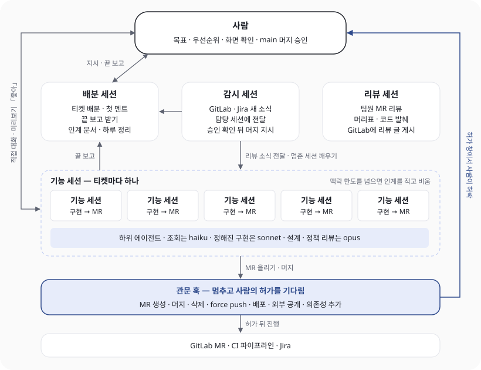

# AI 코딩 에이전트에게 일을 맡기되, 판단은 사람이 쥐는 운영 방식

### 에이전트 하네스

2026.07– · 개인 · PinLog에서 시작해 FINCH · 글로케어까지

<a href="glocare.md"><picture><source media="(prefers-color-scheme: dark)" srcset="https://img.shields.io/badge/글로케어_기록-4C6CB3?style=for-the-badge"></picture></a> <a href="finch.md"><picture><source media="(prefers-color-scheme: dark)" srcset="https://img.shields.io/badge/FINCH_기록-4C6CB3?style=for-the-badge"></picture></a> <a href="pinlog.md"><picture><source media="(prefers-color-scheme: dark)" srcset="https://img.shields.io/badge/PinLog_기록-4C6CB3?style=for-the-badge"></picture></a>

---

**일은 에이전트에게 맡기고, 판단과 승인은 사람이 쥡니다**

> [!NOTE]
> **30초 요약** 글로케어에서는 배분 · 감시 · 리뷰 · 기능 세션을 나눠 돌렸고, 코드는 대부분 에이전트가 썼습니다. 그 코드는 쓴 쪽과 다른 에이전트의 점검, 머리표를 붙인 팀 리뷰, 로컬 · CI 검사를 거치고, 리뷰를 뺀 화면 작업은 사람이 미리보기를 본 뒤에야 MR로 올라갑니다. MR 생성 · 머지 · 삭제 · 배포 · 의존성 추가는 훅이 멈춰 세우고 사람이 허락합니다. 판단을 사람이 쥐는 만큼 병목도 사람에게 있고, 검증을 늘린 효과는 아직 전후로 재지 못했습니다.

---

## 세션을 배분 · 감시 · 리뷰 · 기능으로 나누고, 관문은 사람이 쥠 <!-- kind: 결정 -->

> 2026.10–11 · [프로젝트 기록](glocare.md)

- 외국인 요양보호사 교육 · 취업 지원 서비스(글로케어)의 어드민을 맡아, Claude Code 세션 여럿으로 나눠 작업함
  - 작업 규모: 내 계정으로 올라가 머지된 MR 285건(2026-10-19 ~ 11-20), 완료한 Jira 티켓 201건
- 처음에는 세션 하나가 티켓을 나눠 하위 에이전트에 맡기며 어드민과 인프라를 함께 봄
- 한 세션에 어드민 권한 작업과 CI 설정이 함께 쌓이자, 맥락이 섞인다고 보고 맡은 영역마다 세션을 따로 세우자고 함
  - 선택지 비교, 「담당 영역」이라는 이름, 상태 보드를 지금 상태만 남기는 정리안은 에이전트가 냄
- 지금 구성
  - 배분 세션: 티켓 배분 · 새 세션 첫 멘트 · 끝 보고 받기 · 하루 정리
  - 감시 세션: GitLab · Jira 새 소식을 담당 세션에 전달하고, 승인을 확인한 MR에 머지를 지시함
  - 리뷰 세션: 팀원 MR에 리뷰 글을 닮
  - 기능 세션: 티켓마다 하나, 구현부터 MR · 리뷰 반영까지 맡음. 실무는 일의 종류별 모델 표대로 하위 에이전트에 넘김
  - 세션은 직접 열고, 기능 세션과는 직접 대화함
- 말할 세션이 배분 · 리뷰 · 감시 · 기능으로 흩어져 있다는 문제를 꺼냄
  - 감시를 배분 세션이 맡는 안을 물었고, 비운 세션을 누가 다시 깨우는지 시험 세션을 직접 열어 확인함
  - 비운 세션은 예약도 함께 사라지고 앱의 세션 메시지로만 다시 깨울 수 있다는 결과를 보고, 감시 세션이 사람과 말하지 않고 머지 승인 · 판단 거리만 배분 세션에 한 줄 보내는 구조를 고름
  - 두 세션이 서로 깨우는 구조, 멈춘 세션 점검 규칙, 시험 설계는 에이전트가 냄
- 같은 날 아침에는 감시 세션을 배분 세션이 열게 했다가 되돌림
  - 배분 세션이 연 감시 세션은 알림을 낼 때마다 배분 세션을 다시 깨워 맥락만 늘린다는 설명을 듣고, 직접 열기로 함

---

## AI가 쓴 코드를 어떻게 검증했나

- 코드를 쓴 에이전트가 스스로 괜찮다고 한 것만으로는 main에 넣지 않음
- 어드민 MR은 팀원 리뷰와 승인이 머지 조건이고, 화면만 바꾸는 개편 작업은 팀원 리뷰 대신 사람의 미리보기 확인을 둠
- 단계마다 누가 무엇을 보는지는 아래와 같고, 이어지는 다섯 장이 각 단계를 정한 경위

| 단계 | 누가 보나 | 무엇을 보나 |
|---|---|---|
| 올리기 전 점검 | 코드를 쓴 쪽과 다른 하위 에이전트 | 팀원 리뷰 지적을 유형으로 묶은 체크리스트 |
| 로컬 검사 | 기능 세션 | lint · 포맷 · 타입 검사, 고친 파일 관련 테스트 |
| CI | GitLab 파이프라인 | 전체 테스트 · 빌드 · 파괴적 SQL 검사. 통과가 머지 조건 |
| 팀 리뷰 | 어드민 팀원 · 리뷰 세션(서로의 MR) | 머리표를 붙인 리뷰 글, 근거는 코드 발췌 |
| 화면 확인 | 사람 | 리뷰를 뺀 화면 작업은 미리보기를 보고 「좋아」한 뒤에 MR |
| 관문 | 관문 훅 → 사람 | MR 생성 · 머지 · 삭제 · 배포 · 의존성 추가는 허가 창에서 멈춤 |

---

## 올리기 전 점검을 코드를 쓴 쪽과 다른 에이전트가 돌리게 함 <!-- kind: 결정 -->

> 2026.10 · [프로젝트 기록](glocare.md)

- 레포를 받은 지 이틀째, 팀원이 내 어드민 MR들에 단 리뷰에서 운영에 나갔으면 사고가 됐을 버그가 나옴
  - 관리자 사이트 로그인을 거부하면서 그 사용자의 모든 기기 세션까지 끊는 문제, 서버 컴포넌트에서 토큰 갱신 쿠키가 버려지는 문제 등
- 팀원이 리뷰어에 테스터 역할까지 하고 있다고 보고, 그 테스트를 MR 올리기 전 단계로 옮기자고 함
  - 「그 팀원도 작업을 해야하는 사람이지 리뷰어, 테스터는 아니니까」라는 이유였고, 형식은 체크리스트로 하자고 꺼냄
- 에이전트가 그때까지의 리뷰 지적을 유형으로 묶어 체크리스트를 만듦
  - 환경 · MR 경계 · 실패 경로 · 라이브러리 기본값 · 입력 경계값 · 규칙 우회 · 테스트 · 접근성 등
- 체크리스트는 코드를 쓴 컨텍스트가 아니라 별도 하위 에이전트가 돌리고, 쓴 쪽은 결과 표를 보고 고친 뒤 올림
  - 쓴 쪽이 자기 코드를 보면 같은 가정으로 같은 곳을 놓친다는 이유였고, 이 방식은 에이전트가 정함
- 첫 적용에서 리뷰어가 짚지 않은 지적을 몇 건 더 찾았고, 모두 중간 이하였음
  - 배지 색 작업에서는 리뷰에 없던 글자 대비 부족을 찾아 같이 고침
- 같은 날 어드민 팀원이 올린 리뷰 규칙 문서에 에이전트가 [제안]을 닮
  - 리뷰어만 하던 실행 확인을 작성자도 올리기 전에 돌리자는 내용이었고, 팀원이 반영해 어드민 리뷰 규칙의 작성자 항목이 됨
- 체크리스트를 쓰기 시작한 뒤 내 어드민 MR 가운데 리뷰 지적을 셀 수 있는 91개에서
  - [수정 요청]은 모두 38건, MR당 중앙값 0, [수정 요청]이 하나도 없던 MR이 71%
  - 체크리스트 전 MR은 셀 수 있는 것이 거의 없어 전후 비교가 아님. 같은 날 머리표 규칙도 시작됐고 리뷰 없이 머지되는 경로도 생겨, 이 숫자로 체크리스트의 효과를 가를 수 없음

---

## 팀원 MR 리뷰는 하위 에이전트에 나누고, 근거는 코드 발췌로 달게 함 <!-- kind: 결정 -->

> 2026.10–11 · [프로젝트 기록](glocare.md)

- 어드민 팀원이 쓴 리뷰 규칙은 코멘트 첫 줄에 머리표를 붙이게 함
  - [수정 요청]은 머지 전에 고침, [질문]은 답이 필요함, [제안] · [참고]는 머지를 막지 않음
  - 리뷰어가 직접 검사 · 빌드를 돌리고, 화면이 바뀌었으면 서버를 띄워 확인해야 승인함
- 팀원 MR이 한꺼번에 올라온 날, 세션이 리뷰를 직접 하고 있자 하위 에이전트 여럿에 묶음별로 나눠 맡기게 함
  - 처음 지시문에 팀 리뷰 규칙 문서가 빠져, 게시 직전에 머리표와 승인 조건을 바로잡음
  - 테스트 계정 사용이 자동 권한 검사에 막히자 세션이 대신하지 않고 물었고, 로컬 테스트 계정 로그인을 허락함
  - 그날부터 실무는 하위 에이전트가 하고 세션은 배분 · 결과 확인 · 게시 · 보고만 맡는 것이 규칙이 됨
- 우리 쪽 리뷰 규칙
  - [수정 요청]이 없으면 바로 승인하고, [질문] · [제안]은 작성자 판단으로 반영한 뒤 머지
  - 스레드는 그 스레드를 연 사람만 해결함
- 리뷰 세션의 글이 코드 근거 없이 에이전트 생각으로 읽힌다고 봄
  - 리뷰 세션이 우리 쪽 반영까지 확인하는 안과 코드 리뷰만 제대로 하는 안 가운데 뒤의 것을 고름
  - 스레드마다 해당 코드를 직접 읽고, 문제 줄을 코드 블록과 파일 · 행으로 발췌해 달게 함
  - 실행 · 재현으로 확인한 것과 코드만 읽고 판단한 것을 나눠 적고 확인하지 못한 추측은 달지 않는다는 규칙 문장은 에이전트가 다듬음
- 작업 규모: 리뷰어로 들어간 머지 MR 193건, 리뷰 기록 문서 129건(2026-10-28 ~ 11-17)

---

## push 전에는 빠른 검사만 돌리고, CI 통과를 머지 조건으로 둠 <!-- kind: 결정 -->

> 2026.10–11 · [프로젝트 기록](glocare.md)

- MR마다 GitLab CI 검사 잡(타입 · 린트 · 포맷 · 테스트 · 빌드 · 파괴적 SQL 검사)이 돌고, 파이프라인 성공이 머지 조건
  - CI 구성은 [프로젝트 기록](glocare.md)에 적음
- push 전 로컬에서는 빠른 검사만 돌리는 안을 승인함
  - lint · 포맷 검사 · 타입 검사와 고친 파일 관련 테스트
  - 전체 테스트와 빌드는 CI에 맡기고, 라우트 · 서버/클라이언트 경계 · 프레임워크 설정을 건드렸을 때만 로컬에서도 빌드함
  - CI가 실패하면 감시 세션이 알리고 그 기능 세션이 고침
- MR 검사가 main에 들어가기 전에 막은 실패를 인프라 세션이 스크립트로 집계함
  - 머지된 MR 597개 가운데 12건(2026-10-24 ~ 11-10), 테스트와 파괴적 SQL 검사에서 막힘
  - 같은 커밋을 다시 돌려 통과한 실패는 막은 것으로 세지 않는다는 기준과 스크립트는 세션이 정함
  - 로컬 검사가 미리 걸렀는지는 GitLab에 남지 않아 확인할 수 없음
- 레포가 통째로 회사에 넘어가므로, push 전에 코드 · 주석에 남은 티켓 번호 · 팀원 이름 · 내부 문서 번호를 잡는 검사를 돌리게 함

---

## 리뷰를 뺀 화면 작업은 미리보기를 직접 보고 나서 MR을 올리게 함 <!-- kind: 결정 -->

> 2026.11 · [프로젝트 기록](glocare.md)

- 어드민 MR은 리뷰어 지정 · 승인 · 스레드 해결 뒤에 머지하는 규칙이었음
- 어드민 화면 전체를 손보는 디자인 개편 작업 묶음을 기능 세션 여럿에 나눠 맡기면서, 이 묶음만 팀원 리뷰 없이 자체 검사와 CI 통과 뒤 자동 머지로 넣기로 함
  - 묶음 밖 어드민 작업은 그대로 리뷰어를 거침
  - 뒤에 붙은 후속 작업도 화면만 바꾸면 같은 예외로 두고, 데이터 · 권한 · DB 함수 · 서버 로직을 건드리면 리뷰어를 거치게 함
- 리뷰를 빼는 대신, 일괄 적용 뒤에 고치면 비용이 크다고 보고 작업 하나마다 바뀐 화면을 직접 보고 피드백하게 함
  - 세션은 구현 하나를 마치면 MR 전에 미리보기 서버를 띄워 보여 주고, 「좋아」를 받은 뒤에 MR을 올림
  - 피드백은 크기로 나누는 안을 받아들임. 배치 · 구조 · 흐름이 바뀌는 것은 디자인 캔버스로 돌아가 다시 그리고, 문구 · 간격 · 색 같은 것은 같은 미리보기에서 바로 고침
  - 미리보기 키를 나누는 방식과 보여 주는 형식은 에이전트가 낸 선택지에서 추천안을 고름
  - 미리보기에서는 저장 · 삭제와 관리용 비밀 키를 쓰는 기능을 누르지 않게 함
- 자동 머지를 거는 push 옵션도 관문 훅의 허가 창에서 멈추게 둠

---

## 단계마다 묻는 승인을 main 머지로 좁힘 <!-- kind: 결정 -->

> 2026.10 · [프로젝트 기록](glocare.md)

- 관문은 되돌리기 어려운 일로 정해 둠
  - MR 생성 · 머지, 파일 · 브랜치 삭제와 force push, 배포 · 외부 공개, 의존성 추가
  - 프롬프트에 적은 규칙은 모델이나 도구가 바뀌면 사라지므로, 도구 호출 직전에 훅이 멈추게 함
- 레포를 받은 첫날 세션이 커밋 · push · MR 생성 · 답글을 단계마다 채팅으로 물어, 내 허락을 기다리는 시간이 병목이라고 짚음
- 에이전트가 제안한 「작업 묶음」 단위 승인을 받아들임
  - 선택지와 기각 이유의 정리, 훅 코드는 에이전트가 맡음
- 묶음으로 바꾼 뒤에도 질문이 이어져, 같은 날 채팅으로 묻는 범위를 **main 머지**로 더 좁힘
  - main 머지는 작업 브랜치의 변경을 팀의 기준 브랜치에 합치는 단계임
  - 나머지 관문은 훅의 허가 창 클릭으로 넘김
- 묻는 명령 목록은 규칙 문서가 훅을 따르게 정함
  - 에이전트가 반대로 훅을 문서에 맞춰 줄이려 하자 멈추고, 훅의 목록을 문서에 옮기게 함
- main 머지는 내가 허락해도 리뷰어 승인이 없으면 진행하지 않고, 세션도 승인 · 미해결 스레드 · 승인 글 안의 머지 전 요청을 직접 조회하게 함
- 리뷰 반영 · 답글은 묻지 않고 진행한 뒤 보고하게 함

**이 판단의 한계**

- 머지를 에이전트에게 맡긴 구조에서 확인 절차의 빈틈이 사례마다 드러남
  - 승인 글 안에 남은 「머지 전에 설명 문구를 맞춰 달라」는 요청을 놓치고 머지한 일이 있었고, 그 뒤 올리기 전 체크리스트 첫 절에 승인 글 안의 요청을 보는 항목이 들어감
- 빈 곳은 사례마다 메웠고, 교훈 문장과 확인 방법의 정리는 에이전트가 맡음

---

## 토큰이 빨리 닳는 원인을 재게 했고, 내 가설은 절반만 맞았음 <!-- kind: 틀림 -->

> 2026.11 · [프로젝트 기록](glocare.md)

- 사용량이 너무 빨리 닳는다고 느껴 어디에 쓰이는지 조사하게 함
  - 가설은 개인 저장소 루트에서 세션을 여니 글로케어와 무관한 문서까지 읽는다는 것이었음
- 세션이 대화 기록을 읽어 글로케어 세션 141개와 하위 에이전트 589회를 재고, 원인 순위를 냄
  - 무관한 문서를 읽은 몫은 작아, 가설의 절반은 틀렸음
  - 루트의 지침 · 메모 · 스킬 목록이 모든 세션과 하위 에이전트에 자동으로 붙는다는 절반은 맞았음
  - 가장 큰 원인은 세션을 오래 끄는 것이었고, 메인 호출 한 번의 평균 맥락이 324k였음
  - 다음은 하위 에이전트였고, 거의 전부 가장 비싼 모델로 돌고 있었음
- 원인 순서대로 운영 규칙을 고침
  - 세션 수를 늘리지 않고, 맥락이 커지거나 리뷰를 기다리게 되면 인계 몇 줄을 적고 세션을 비우게 함
  - 하위 에이전트 모델을 일의 종류별로 고르는 표를 먼저 꺼냄. 무엇을 남길지 판단하는 요약 · 정리는 낮은 모델에 맡기지 말자고 해 표를 한 번 더 나눔
  - 매번 붙는 규칙 · 상태 문서는 지금 것만 남기게 줄이고, 감시는 따로 떼어 새 소식이 있을 때만 깨우는 안을 승인함
  - 규칙만으로는 세션이 자기 크기를 재지 않아, 턴 끝에 훅이 맥락을 재게 하자고 함. 500k를 넘으면 훅이 인계를 적고 비우라고 알림
- 측정 방법 · 원인 해석 · 해결안 대부분은 세션이 냄
- 고친 뒤 비용이 실제로 줄었는지는 같은 스크립트로 다시 재지 않았음

---

## 바뀌어 온 순서

- PinLog(2026.07–08, 6인 팀)에서는 규칙 문서를 두고 시작해, 하나씩 지시하던 순차 작업에서 커밋 전 보고 · 승인 절차를 거쳐 병렬 작업으로 옮겨 감
  - 각 세션을 직접 상대하다 감독 창구 하나를 거치게 했다는 것이 당시 과정을 돌아본 본인 회고였음
- FINCH(2026.08–09, 5인 팀)에서는 감독 · 실행 · 학습 세 계층으로 나눔
  - 작업을 배정하고 검토하는 대화에서 모르는 개념을 공부하는 대화를 따로 뺌
- 취업 준비(2026.08–, 개인)에서는 에이전트가 쓸 재료를 근거 있는 경험 기록으로 한정함
  - 기록마다 근거와 확인 상태를 붙이고, 기록에 없는 경험은 쓰지 않게 함
- 글로케어(2026.10–11, 6인 기업 연계 팀 프로젝트)에서는 배분 · 감시 · 리뷰 · 기능 세션으로 나눔
  - 관문은 실행 전 훅이 멈추게 하고, 채팅으로 묻는 범위는 main 머지로 좁힘
  - AI가 쓴 코드는 위의 검증 단계를 거쳐 main에 들어가게 함

---

## 금지 옆에 허용되는 행위를 함께 적음 <!-- kind: 결정 -->

> 2026.07–08 · [프로젝트 기록](pinlog.md)

- 프론트엔드 기능 구현을 맡으며 에이전트에게 규칙 문서를 주고 작업시킴
- 문서에 있던 「프론트는 토큰을 저장하지 않는다」를 에이전트가 「재발급 로직 자체를 만들지 말라」로 읽음
  - 로그인 상태를 증명하는 토큰의 저장 금지가, 인증 실패 응답인 401을 받은 뒤 복구하는 동작까지 막은 셈이었음
  - 그 결과 401 복구가 통째로 빠짐
- 토큰 저장 금지는 유지하고, 혼동한 인접 행위를 같은 항목에 붙임
  - 재발급은 반드시 하되 토큰 값을 읽거나 보관하지 않는다고 함께 적음
- 이후 규칙도 금지만 쓰지 않고, 혼동하기 쉬운 행위 중 허용되는 것을 나란히 적는 형식으로 통일함
- 같은 오독은 다시 나오지 않았음

---

## 병렬화가 병목을 없앤 것이 아니라 나에게로 옮겼다고 판단함 <!-- kind: 틀림 -->

> 2026.07–08 · [프로젝트 기록](pinlog.md)

- 순서대로 지시하던 작업을 동시에 진행하려고 `git worktree`로 작업 공간을 나눔
  - 같은 저장소를 서로 다른 폴더와 브랜치에서 작업하게 하는 기능을 이용함
- 처음에는 공간을 나누는 것만으로 작업이 분리되지 않았음
  - 같은 기능을 중복 구현하는 일이 생김
  - 병렬 개발 서버의 접속 주소가 외부 서비스에 등록되지 않아 생긴 인증 오류를 코드 문제로 오인함
  - 앞선 브랜치를 변경 이력 하나로 합친 뒤, 그 위에서 시작한 브랜치에 충돌이 남음
- 작업 분할 기준을 폴더에서 **실제로 고칠 파일 목록**으로 바꿈
  - 티켓마다 대상 파일을 먼저 정하고, 파일이 겹치는 작업은 같은 작업 공간에서 순서대로 진행함
  - 파일이 겹치지 않아도 서로의 동작 조건에 영향을 주면 순서를 고정함
- 재분할 뒤 코드 병합 요청인 PR 3건의 파일 목록을 대조하니 교집합이 0이었음
  - 모두 충돌 없이 병합 가능한 `MERGEABLE/CLEAN` 상태였다는 것은 2026년 8월 당시 관찰값이었음
  - 이미 병합된 요청들이어서 현재 같은 상태값을 다시 조회할 수는 없음
- 그 뒤에도 세션마다 검토 · 실행 승인 · 다음 지시를 기다리는 일이 반복됐다는 것이 본인 회고였음
  - 여러 작업이 어디까지 갔는지 직접 따라가는 것도 어려웠다고 돌아봄
- 병렬화로 병목이 사라진 것이 아니라 내 응답과 검토로 옮겨 왔다고 판단함
- 모든 세션을 직접 상대하는 대신 감독 세션 하나를 거치게 함
  - 작업 배정 · 중간 검토 · 상태 관리는 감독 세션에 맡기고, 나는 그 창구와 소통하게 함

---

## 작업을 감독하는 자리에서 학습하는 자리를 따로 뺌 <!-- kind: 결정 -->

> 2026.08–09 · [프로젝트 기록](finch.md)

- 감독관 · 워커 두 계층으로 프론트엔드 구현을 시작함
  - 감독관은 작업 배정과 검토를 맡고, 워커는 나눠 받은 구현을 맡음
- 감독관에게 배정 · 검토 · 상태 관리가 모인 위에 개념을 묻는 학습 대화까지 섞였다고 회고함
  - 그 과정에서 설명을 나누는 자리가 필요했다고 판단함
- 대화창만 나누면 설명은 여전히 세션과 함께 사라지는 문제가 있었음
  - 학습 전용 에이전트인 튜터를 따로 두고, 설명을 팀 코드 저장소 밖의 학습 노트에 쌓게 함
- 감독 · 실행 · 학습 세 계층으로 나눠 운영함
  - 감독관은 작업 분해 · 배정 · 승인 관문 · 이슈와 병합 요청 상태를 맡음
  - 워커는 티켓별 작업 공간과 브랜치에서 구현을 맡음
  - 튜터는 모르는 개념을 설명하고 학습 노트를 남김

**이 판단의 한계**

- 역할을 나눈 뒤에도 지시를 많이 쓰는 것이 항상 도움이 되지는 않았음
- 디자인 시안 셋을 경쟁시키면서 기존 정보 구조를 가져다 쓰고 화면 부품의 이름 · 입력 형태는 방향 사이에 같게 유지하라는 제약을 함께 걸었음
  - 결과는 색과 그림자만 다르고 배치가 거의 같았음
  - 서로 다른 방향을 고르려고 만든 선택지를 내 제약으로 수렴시킨 판단 착오였음

---

## 기억 대신 근거가 붙은 기록만 재료로 쓰게 함 <!-- kind: 결정 -->

> 2026.08– · 개인

- 포트폴리오를 정리하다 내 기억이 실제 코드 · 커밋과 여러 곳에서 다르다는 것을 확인함
- 2026년 8월 초부터 경험을 하나씩 문서화하는 개인 저장소를 만들기 시작했다는 것이 본인 진술이었음
- 경험마다 근거 자료와 확인 상태를 붙임
  - 커밋 해시 · PR 링크 · 증빙 파일을 연결하고, 근거가 없거나 대조하지 못한 기록은 그 상태를 표시함
  - 직접 정한 것과 에이전트가 제안한 것을 구분하는 항목도 따로 둠
- 에이전트는 그 기록만 재료로 초안을 쓰게 함
  - 기록에 없는 경험은 쓸 수 없게 함

**이 판단의 한계**

- 기록을 만들었다고 내용 확인까지 끝난 것은 아니었음
  - 처음에 기록을 한꺼번에 만들며 다 읽어 보지 못했고, 형식도 바꾸면서 기록이 계속 수정되고 있다는 것이 본인 진술이었음
- 여러 기기를 써야 해 비공개 원격 저장소에 올려야 했다는 것이 본인 진술이었음

---

## 검증을 늘렸지만 그 효과를 전후로 재지는 못함 <!-- kind: 남김 -->

> 2026.10–11 · [프로젝트 기록](glocare.md)

- 올리기 전 체크리스트와 머리표 규칙이 같은 날 시작돼, 그 전 값이 거의 없음
  - 리뷰 지적 수는 도입 뒤 값만 있음
  - 리뷰 없이 머지되는 경로 · MR 크기 · 시간이 지나며 쌓인 익숙함도 같이 바뀌어, 어느 것이 지적을 줄였는지 가를 수 없음
- CI가 막은 실패 집계는 세션이 만든 스크립트의 출력이고, 일부 MR 화면과 맞대 본 것 말고는 다시 대조하지 않았음
- 리뷰 근거를 코드 발췌로 달게 한 뒤 리뷰 글이 실제로 그 꼴로 바뀌었는지, 팀원 반응이 어땠는지는 아직 열어 보지 않았음
- 같은 스크립트로 집계를 이어 가고, 리뷰 스레드를 골라 발췌 꼴로 바뀌었는지 직접 확인하는 일이 다음 과제로 남음

---

## 화면이 어떻게 보이는지 판단하는 단계가 한 사람에게 남음 <!-- kind: 남김 -->

> 2026.09 · [FINCH 기록](finch.md) · 2026.11 · [글로케어 기록](glocare.md)

- FINCH에서 구현을 맡은 에이전트는 격리된 작업 공간에서 타입 검사 · 코드 규칙 검사 · 빌드까지 확인함
- 작업 기록 여러 건이 「브라우저로 실제 화면을 보지 못함」으로 끝났고, 실제 모양을 판단하는 단계가 나 한 사람에게 남음
  - 원격 디버깅으로 화면을 띄운 예외가 한 번 있어, 고정된 한계는 아니었음
- 자동 검사를 통과한 코드에서도 화면을 열어야 보이는 문제가 나옴
  - 보유 카드의 손익 색이 검정으로만 보였음
  - 시세가 없는 종목의 안내 문장이 크게 표시돼, 일부 값이 없는 상태가 전면 장애처럼 읽혔음
- 손익 색의 원인으로 댄 추정은 빗나갔고, 실제 원인은 에이전트가 찾음
- 화면 판단을 덜어 보려고 프로토타입과 구현을 비교하는 표도 쓰게 했으나 접음
  - 표가 화면 수정으로 제대로 이어지지 않았고, 없어진 화면 요소와 밀린 코드 위치를 그대로 가리키며 낡았음
- 프로토타입과 개발 서버 화면을 나란히 놓고 직접 보며 피드백하는 방식으로 돌아옴
- 글로케어에서는 이 단계를 절차로 못 박음
  - 리뷰를 뺀 화면 작업은 사람이 미리보기를 보고 「좋아」해야 MR이 올라가고, 전후 캡처는 티켓마다 보관하게 함
- 절차가 생긴 만큼 화면 판단은 더 분명하게 한 사람에게 모임
  - 한 사람이 빠지면 화면 판단 단계도 빠지는 구조는 FINCH 때와 같음

---

## 기여의 범위

| 내가 결정한 것 | 에이전트가 만든 것 |
|---|---|
| 금지 옆에 허용되는 인접 행위를 함께 적도록 함 | 규칙에 따라 작성한 구현 코드 |
| 모든 세션을 직접 상대하던 접점을 감독 창구 하나로 줄임 | 배정받은 작업의 구현 코드 |
| 작업을 감독하는 자리와 학습하는 자리를 나눔 | 워커의 구현과 튜터의 학습 노트 |
| 경험마다 근거와 확인 상태를 붙이고 그 기록만 재료로 쓰게 함 | 기록을 재료로 쓴 지원서 초안 |
| 맡은 영역마다 세션을 따로 세우자고 함 | 선택지 비교 · 상태 보드 정리안 |
| 말할 세션이 흩어진 문제를 꺼내고, 시험 결과를 보고 감시 세션이 사람과 말하지 않는 구조를 고름 | 두 세션이 서로 깨우는 구조 · 멈춘 세션 점검 규칙 · 시험 설계 |
| 리뷰어에게 기대던 테스트를 올리기 전 점검으로 옮기자고 함 | 체크리스트 항목 · 다른 하위 에이전트가 돌리는 방식 |
| 팀원 MR 리뷰를 하위 에이전트에 나눠 맡기고, 근거를 코드 발췌로 달게 함 | 리뷰 내용 · 리뷰 근거 규칙 문장 |
| push 전 빠른 검사와 CI 통과를 머지 조건으로 두는 안을 승인함 | 검사 구성 · CI가 막은 실패 집계 스크립트 |
| 화면 개편 작업은 팀원 리뷰 대신 미리보기 「좋아」 뒤에 MR을 올리게 함 | 미리보기 키 공유 · 보여 주는 형식(추천안을 고름) |
| 채팅으로 묻는 범위를 main 머지로 좁히고 훅 목록을 정본으로 둠 | 관문 훅 코드 · 선택지와 기각 이유 정리 |
| 토큰 조사를 요청하고 가설을 냄, 맥락은 턴 끝에 훅으로 재자고 함 | 측정 스크립트 · 원인 순위 · 해결안 대부분 |
| 기기를 오갈 때의 문제를 제기하고 제안된 방식의 구멍을 질문으로 짚음 | 동기화 훅 구조와 스크립트 |

- 어드민 리뷰 규칙의 머리표 · 승인 조건 · 작성자 자체 점검 항목은 어드민 팀원이 문서에 넣음

---

## 도구

 

- [Orca](https://www.onorca.dev/)는 Claude Code·Codex 같은 CLI 에이전트를 워크트리마다 하나씩 병렬로 돌리는 오픈소스 에이전트 개발 환경
- FINCH는 Orca 위에서, 글로케어는 Claude Code 세션 여럿과 하위 에이전트로 운영함
  - 관문 · 맥락 재기 · 기기 사이 인수인계는 Claude Code 훅에 맡김. 훅 구조와 스크립트는 에이전트가 제안한 것을 검토해 채택함
  - PinLog에서 도구를 바꿀 때 규칙과 절차는 이어 쓰고 명령 정의만 다시 썼다는 것이 본인 진술이며, 저장소에는 Claude Code용 지침 파일이 공통 규칙 문서(`AGENTS.md`)를 한 줄로 참조하는 구조가 남아 있음

---

- 이전 판은 [`_archive/2026-11-20_harness_글로케어판전.md`](_archive/2026-11-20_harness_글로케어판전.md)(FINCH 중심 판)와 [`_archive/2026-10-28_harness_볼트재작성전.md`](_archive/2026-10-28_harness_볼트재작성전.md)에 보관
