

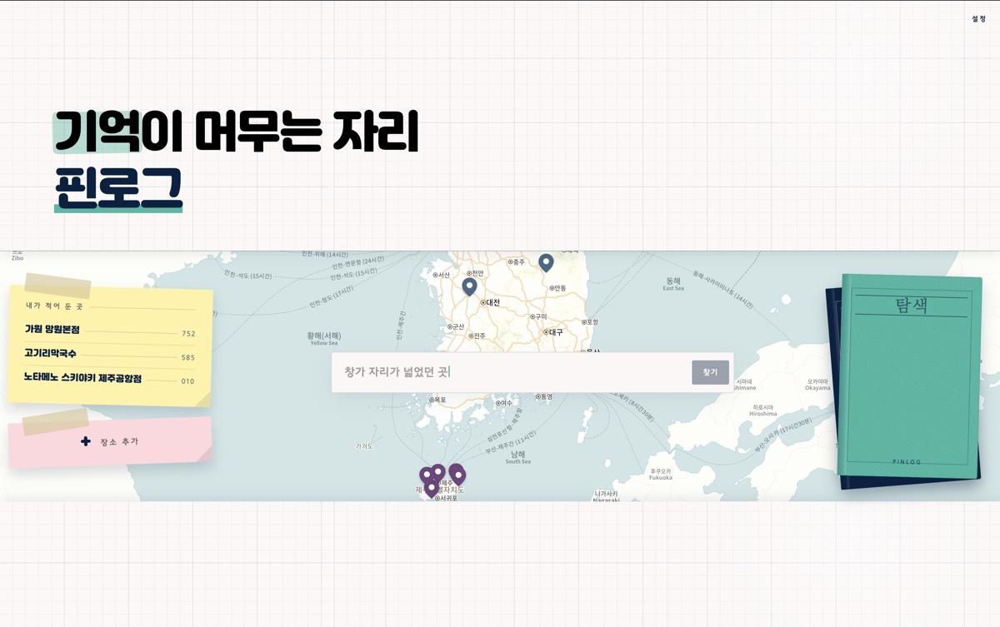

# 장소 이름이 기억나지 않아도 경험과 감정으로 다시 찾는 AI 장소 기록 서비스

### PinLog

2026.07–08 · 5주 · 6인 · SSAFY 공통 · 프론트엔드 기능 구현

<a href="https://youtu.be/lD5MbHL9TZ8"><picture><source media="(prefers-color-scheme: dark)" srcset="https://img.shields.io/badge/Demo-4C6CB3?style=for-the-badge&logo=youtube&logoColor=white"></picture></a> <a href="https://github.com/Team-PinLog/front"><picture><source media="(prefers-color-scheme: dark)" srcset="https://img.shields.io/badge/Repo-4C6CB3?style=for-the-badge&logo=github&logoColor=white"></picture></a>

---

**개선은 수치와 코드로 확인하고, 이해하지 못한 것과 끝내지 못한 것은 남김**

- 팀은 백엔드 · 프론트엔드 · AI · 인프라 파트로 나뉘어 있었음
- 팀 조직은 [Team-PinLog](https://github.com/Team-PinLog)에 있음

> 서비스는 2026.08 배포 종료, 아래 화면은 종료 직전 기록

## 만든 것

- 6인 팀에서 프론트엔드 기능 구현을 맡음
- 프론트엔드 저장소 커밋 206건 중 178건 담당
- 주요 기능
  - **자연어 검색** — 저장해둔 맥락을 문장으로 다시 찾는 화면, 서비스의 핵심 기능
  - **장소 추가** — 사진에서 장소를 추출하는 경로와 검색으로 찾는 경로 두 가지
  - **지도와 레코드** — 마커에서 레코드 상세로 이어지는 흐름
  - **피드·라이브러리·컬렉션** — 레코드 저장과 팔로우
  - **인증** — 토큰 만료 시 재발급 처리
- 자연어 검색의 엔진(임베딩과 관련도 판정)은 AI 파트가, 소유권 확인과 AI 호출 조율은 백엔드가 맡음
  - 내 몫은 그 검색 결과를 받아 지도와 함께 보여주는 화면
- UI/UX는 동료([@ghkim1632](https://github.com/ghkim1632))가 담당했고, 그 목업을 기준으로 API·라우팅·기능을 구현함
- 디자인 개편 뒤에는 화면 개선에도 직접 참여함
  - 이후 재개선 때는 인프라 담당자의 도움도 받음

### 화면

> AI 응답 대기와 타이핑 구간은 배속 처리함

1. **자연어 검색** — 저장한 맥락을 문장으로 다시 찾음
   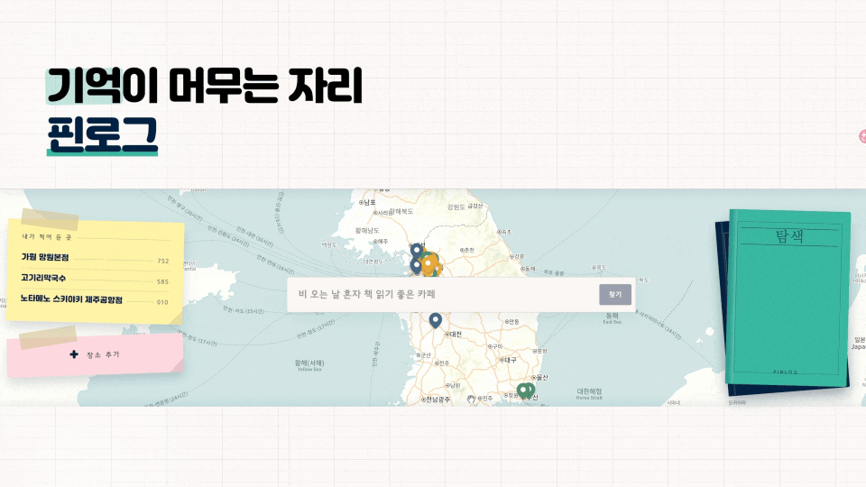
2. **장소 추가 (이미지)** — 사진에서 장소를 추출해 기록
   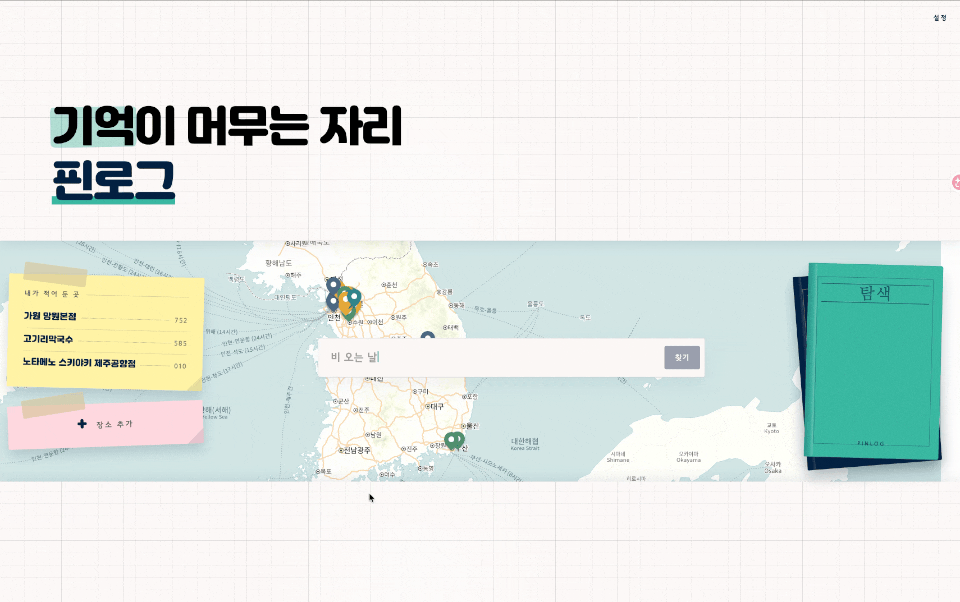
3. **장소 추가 (텍스트)** — 검색으로 장소를 찾아 기록
   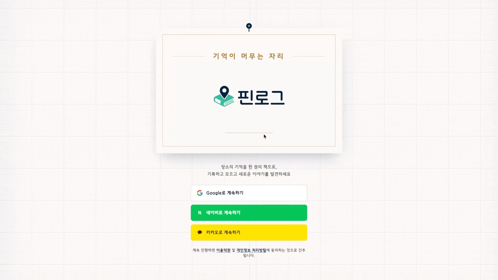
4. **지도 마커 → 레코드 상세**
   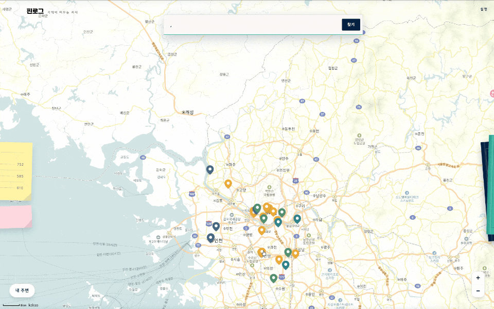
5. **피드** — 레코드 저장과 팔로우
   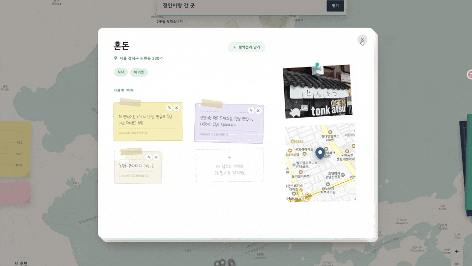
6. **라이브러리**
   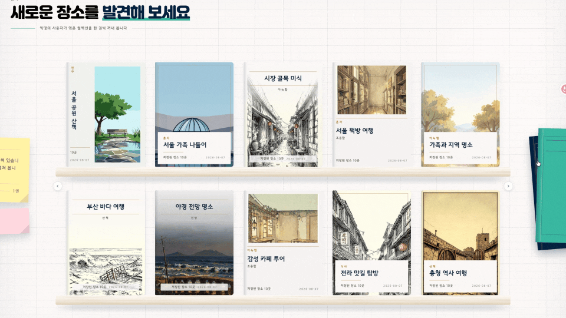

| | | |
|---|---|---|
| 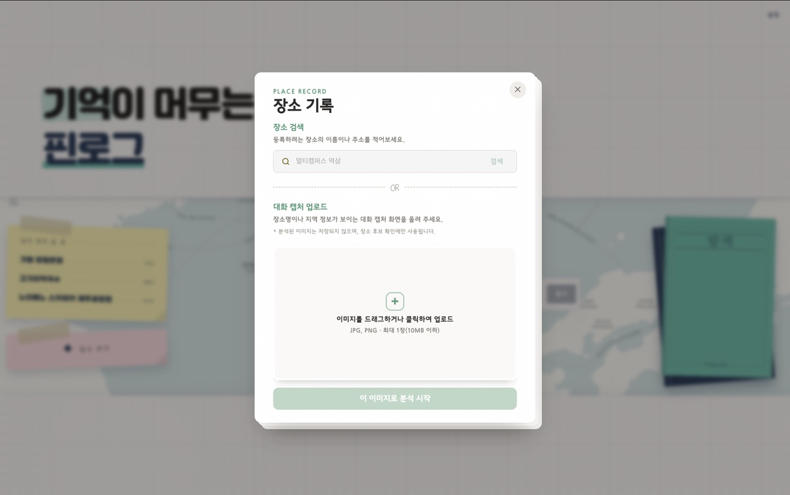 장소 추가 | 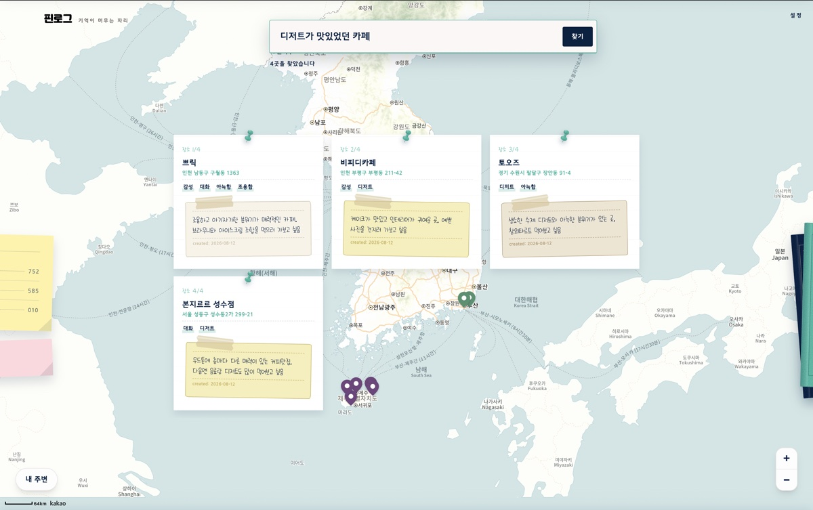 검색 결과 | 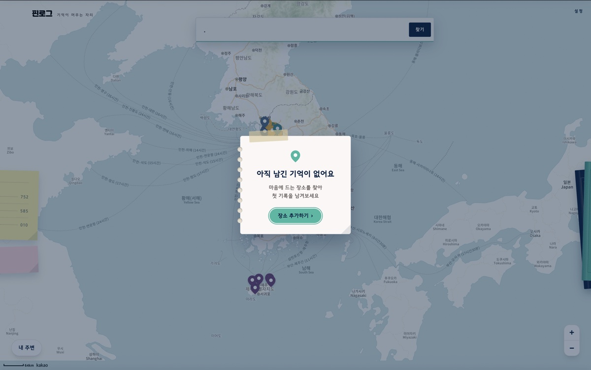 검색 결과 없음 (빈 상태 처리) |
| 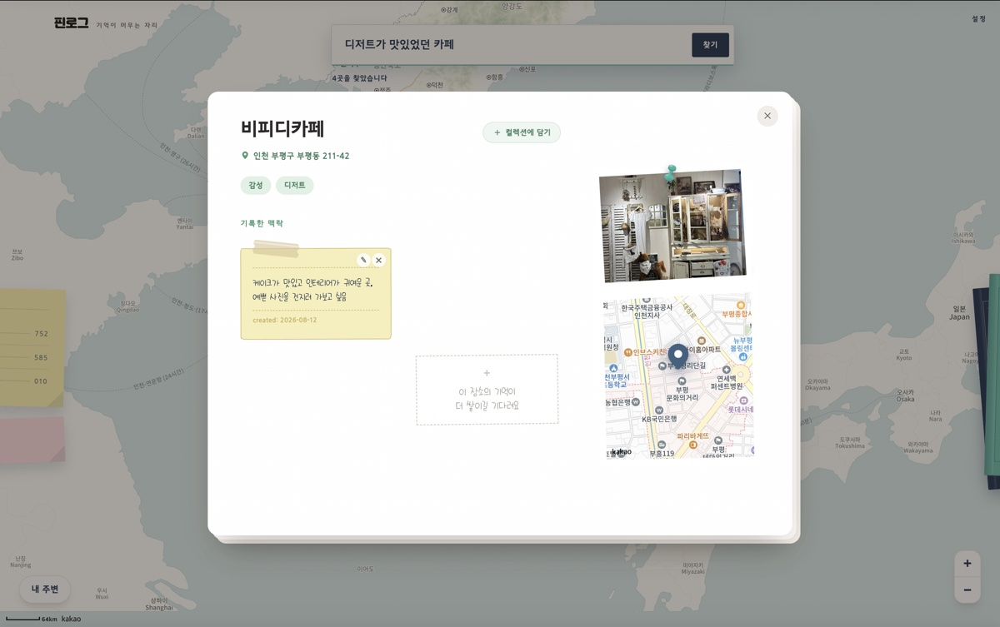 레코드 상세 | 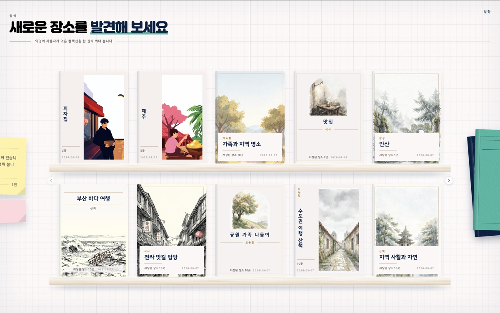 피드 | 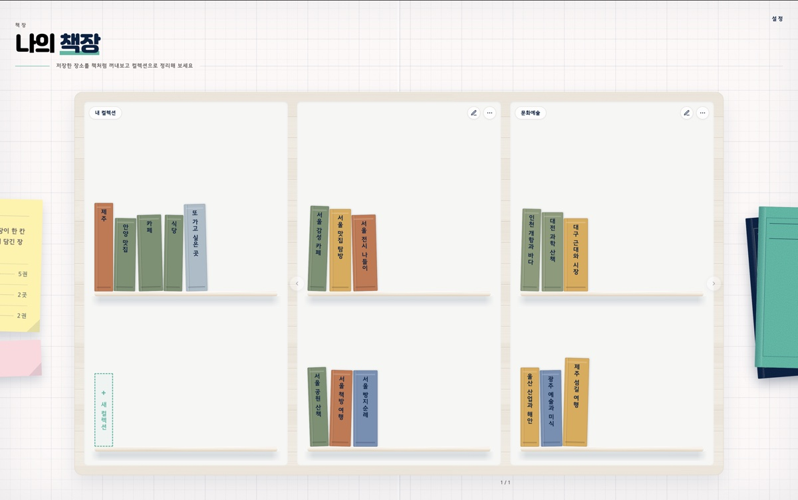 라이브러리 |
| 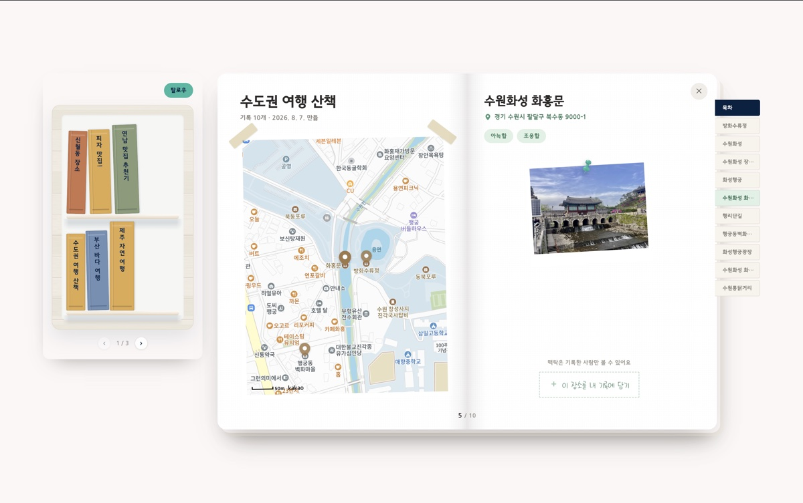 컬렉션 상세 | | |

---

## 서체를 바꾸지 않고, 받는 시점을 앞당기는 안을 수치로 검증함 <!-- kind: 결정 -->

- 검색 결과 카드가 먼저 뜨고, 뒤늦게 서체가 바뀜
  - 결과에 쓰는 서체(469KB)를 결과가 뜬 뒤에야 내려받기 시작했기 때문
- 기각한 안
  - 더 가벼운 서체로 교체 — 적용하지 않음
  - 모든 화면에서 처음부터 미리 받기 — 검색하지 않는 사용자도 469KB를 받고, 첫 화면 서체와 내려받기를 다퉈서 접음
  - 글자 범위별 파일 분할 — 나눈 파일의 합계가 원본보다 크고, 대표 문장이 나뉜 범위를 모두 써서 요청이 줄지 않아 접음
- 개선이 필요하다고 보고 수치 검증을 요구함
- 검색창에 커서가 들어올 때 서체를 미리 받자고 제안함 — 커서 진입은 곧 결과를 볼 가능성이 높다는 신호
  - 비슷한 방식은 이미 코드에 있었음. 내 몫은 그 효과를 숫자로 확인하게 한 것
- 측정은 이전에 받은 서체가 결과에 영향을 주지 않는 상태에서 진행

| 지표 | 변경 전 | 변경 후 |
|---|---|---|
| 페이지 진입 후 서체 내려받기 시작 | 913ms | 149ms |
| 결과 표시 대비 서체 준비 시점 | 약 11ms 뒤 | 약 806ms 전 |

- 데이터 사용량은 469KB로 그대로
- 파일을 줄이는 대신 받는 시점을 앞당겨, 결과 표시 전에 서체가 준비됨을 확인

---

## 토큰 재발급을 한 번으로 묶는 안을 테스트로 확인함 <!-- kind: 결정 -->

- 여러 API 요청이 동시에 나가는 상황이 있었음
- 이 요청들이 함께 401, 즉 인증이 만료됐다는 응답을 받으면 각 요청이 토큰 재발급을 따로 호출할 수 있었음
- 재발급 요청에도 같은 처리가 적용되면 재발급이 다시 재발급을 부르는 위험도 있었음
- 에이전트가 진행 중인 재발급을 다른 요청들이 함께 기다리는 single-flight 방식을 제안하고 구현함
  - 원래 요청은 재발급이 끝난 뒤 한 번만 재시도
  - 재발급 요청 자체는 이 처리에서 제외
- 내가 확인한 기준 셋
  - 동시에 인증이 만료돼도 재발급은 한 번만 나갈 것
  - 재발급이 자기 자신을 다시 호출하지 않을 것
  - 원래 요청이 무한히 재시도되지 않을 것
- 테스트 4건의 코드와 통과 결과를 확인한 뒤 승인함
- 테스트에 포함된 경우
  - 단일 요청의 재시도 성공
  - 동시 요청에서 재발급을 한 번만 호출하는 경우
  - 재발급 자체가 401을 받으면 다시 시도하지 않는 경우
- 재발급을 함께 기다리는 구조와, 재발급 실패 뒤 사용자를 어디로 보낼지는 별개의 문제였음
  - 실패 후 복구 경로는 남은 과제로 구분함

---

## 레코드를 만들어도 지도가 그대로였음 <!-- kind: 결정 -->

- 장소 기록인 레코드를 만들거나 지워도 지도와 컬렉션 화면에는 예전 데이터가 남았음
- 장소에 붙인 경험·감정·목적을 수정하는 경우에도 여러 화면이 영향을 받았음
- 일부 변경 처리에는 성공 뒤 저장된 데이터를 갱신하는 처리가 없었음
- 에이전트가 변경 작업마다 실제로 바뀌는 데이터와 그 데이터를 읽는 화면을 짝지어 정리함
  - 레코드 생성·강제삭제는 지도와 목록의 캐시를 무효화해 다시 읽게 함
  - 경험·감정·목적의 수정·삭제는 컬렉션 상세를 갱신함
  - 삭제된 상세 데이터는 캐시에서도 제거함
- 내가 어떤 변경 뒤에 갱신이 빠졌는지 지도, 내 레코드 목록, 컬렉션 상세 등 화면별로 검토하고 승인함
- 함께 검토한 설명
  - 전체 캐시를 초기화하는 안은 영향 범위가 과도했음
  - 서버 응답 전에 화면부터 바꾸는 낙관적 업데이트를 일괄 적용하는 안은 중복 처리 위험이 있음
- 이 구분은 레코드 생성·강제삭제와 기록 내용 변경 후 지도·컬렉션 화면의 데이터가 맞도록 개선하는 데 반영됨
- 무효화 대상을 정리한 것은 에이전트, 내 몫은 화면별 누락을 검토하고 그 구분을 승인하는 일

---

## 만드는 속도를 이해하는 속도가 따라가지 못함 <!-- kind: 틀림 -->

- 프론트엔드 저장소 커밋의 대부분이 내 이름
  - 하지만 코드의 상당 부분은 내가 직접 타이핑한 것이 아니라 에이전트가 만든 것
- 프로젝트 초반에는 에이전트가 구현뿐 아니라 구조까지 잡아 줌
- 코드가 나오는 속도를 내가 이해하는 속도가 따라가지 못함
- 내가 판단한 범위와 에이전트가 제안하거나 구현한 범위는 아래와 같음

| 내가 판단한 것 | 에이전트가 만든 것 |
|---|---|
| 동시 재발급·재귀·무한 재시도 위험을 테스트로 확인해 승인함 | single-flight 방식을 구상하고 구현함 |
| 캐시 갱신이 빠진 곳을 화면별로 검토해 승인함 | 변경 작업별 무효화 대상을 정리함 |
| 구현된 것과 제안된 것의 구분을 검토해 승인함 | 재발급 실패 지점을 진단하고 완료 범위와 제안 범위를 구분함 |
| 탭 간 재발급 공유, 서버 일시 오류인 503과 인증 만료인 401의 분리, 응답이 정해진 형식인지 확인하는 스키마 검사를 검토·승인함 | 그 구조를 제안함 |

- 후반에는 인증 흐름 코드를 직접 따라 읽으며 "이걸 지우면 뭐가 깨지나"에 답하는 방식으로 공부함
- 그렇게 격차를 좁혔지만 완전히 메우지는 못함
- 다음에는 생성된 코드를 그 자리에서 따라 읽는 것을 절차에 넣을 예정

---

## 재발급 실패 뒤 복구 경로는 완료로 쓰지 않고 남김 <!-- kind: 남김 -->

- 토큰 재발급 자체가 401로 실패하면 세션을 복구할 방법이 없었음
- 실패를 공통으로 받아 로그인 화면으로 보내는 흐름도 당시에는 없었음
- 코드에는 로그인 이동을 다음 인증 작업에서 처리한다는 주석이 남아 있었음
- 에이전트가 재발급 실패가 끝나는 지점을 확인하고, 세션 정리·로그인 이동·전용 안내를 묶는 방안을 제안함
  - 이 방안은 이슈로 남김
- 내가 구현된 것과 제안된 것의 구분을 검토해 승인함
- 후속 PR을 직접 확인하지 않았으므로 복구 경로까지 완료됐다고 쓰지는 않았음
- 그 밖에 남긴 항목
  - **반응형** — PC 기준으로만 확인함
  - **폰트 서브셋** — WOFF2 파이프라인을 만들려다 [라이선스 문제](https://github.com/Team-PinLog/front/blob/dev/docs/troubleshooting/2026-08-07-free-font-license-blocks-subset-pipeline.md)로 멈췄고, 대체안을 넣을 시간이 없었음
  - **AI 응답 대기** — 자연어 검색과 사진 기반 장소 추출은 응답에 몇 초가 걸리는데, 스피너 말고 다른 방법은 손대지 못함
- 셋 다 알고 있었지만 순서에서 뒤로 밀었음

---

## 에이전트와 일한 방식

- 구현의 상당 부분을 에이전트에게 맡김
- 규칙과 확인 관문을 먼저 적고 시작해, 실패할 때마다 고침
- 여러 에이전트를 병렬로 돌리다 겪은 실패와 재설계는 따로 적었음

[상세 보기 — 에이전트 하네스 · PinLog](harness.md#금지-옆에-허용되는-행위를-함께-적음)

---

## 기술 스택

- React 19 · TypeScript · Vite · TanStack Router/Query · Tailwind CSS · Axios · Zod · React Hook Form · Vitest
- Nginx 정적 이미지 · Kubernetes 배포 (Infra 저장소 GitOps 경계)
- 구조와 데이터 흐름은 [`docs/architecture.md`](https://github.com/Team-PinLog/front/blob/dev/docs/architecture.md)에 있음
- 트러블슈팅 기록은 16건(2026.08.25 기준), [`docs/troubleshooting/`](https://github.com/Team-PinLog/front/blob/dev/docs/troubleshooting/README.md)에 있음

---

- 정리 이전 판은 [`_archive/2026-08-17_pinlog_검증전원본.md`](_archive/2026-08-17_pinlog_검증전원본.md)와 [`_archive/2026-10-27_pinlog_볼트재작성전.md`](_archive/2026-10-27_pinlog_볼트재작성전.md)에 보관
- 무엇을 왜 뺐는지는 [`_archive/README.md`](_archive/README.md) 참조
